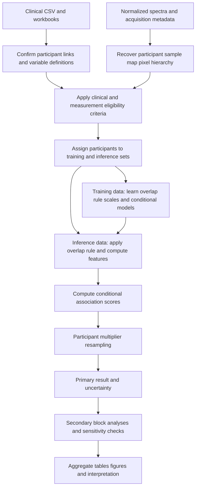

# Conditional Testing with Unequal Technical Replication

## Research proposal

**Proposed manuscript title:** *Conditional Testing with Unequal Technical Replication: Finite-Order Distributional Inference for Biomedical Spectroscopy*

**Date:** 21 October 2026.

**Status:** Research design. The proposed conditional test has no completed implementation, proved calibration result, or measured clinical performance. Existing cohort results and a small synthetic calculation motivate the study; they do not establish the proposed method's validity.

Investigators already know the cohort's earlier results. Specifying this additional analysis before running it documents a new research decision; it does not make the original study independently preregistered or turn the same participants into an external validation cohort.

**Primary application:** Raman measurements of circulating extracellular-vesicle-enriched fractions from stroke participants and controls.

**Intended readership:** Researchers working on statistical machine learning, biomedical pattern recognition, repeated measurements, and learning with sets of observations.

## 1. Research goal and central idea

Develop a conditional association test for a modality that supplies several dependent measurements per participant, with different amounts of technical replication across groups. The method should detect differences in specified distributional features while maintaining an appropriate false-positive rate under its stated assumptions.

The Finnish Raman cohort provides a concrete example. Controls generally contribute one technical sample with three mapped areas per spectral block; most stroke participants contribute two technical samples with six mapped areas per block. The investigator confirmed that the two sample labels represent technical replicates of one blood collection. They do not represent separate clinical visits.

A participant median gives every participant one row, but its precision depends on how much measurement information contributes to that row. Squaring a noisy participant average can also introduce a second-moment bias that depends on replication count. These effects matter when the research question concerns heterogeneity rather than only a group average.

The proposed method retains the hierarchy, estimates first- and second-order spectral features using distinct maps, and compares their conditional expectations after accounting for clinical covariates. It gives participants equal population weight. Extra technical measurements can improve precision without changing the intended population weighting.

The study has four objectives:

1. Define the distributional features that a small, fixed number of maps can identify under explicit measurement assumptions.
2. Develop a conditional test and derive the conditions under which its significance levels remain valid.
3. Compute map-pair comparisons efficiently, using all eligible measurements without treating them as additional participants.
4. Evaluate the method through simulations, public datasets, and a carefully restricted Finnish application.

The clinical question concerns association beyond measured pre-event covariates. A statistically supported association would not establish causation, molecular identity, diagnostic usefulness, or brain origin of the measured particles.

## 2. Existing evidence and why it matters

The evidence below comes from the repository review and local data checks conducted during the development of this proposal. Counts describe the inspected files and saved results; the final analysis must regenerate them using a documented input version.

| Observation | Evidence available | Consequence for this study |
|---|---|---|
| Spectral cohort | 97 stroke participants and 50 controls | Use 147 as the maximum participant count before linkage, measurement eligibility, and covariate restrictions. |
| Clinical linkage | All 102 rows in `clinical_data.csv` match unique primary database identifiers in the larger workbook; age and sex agree. | The larger workbook can extend the clinical descriptions of these participants. |
| Spectral stroke linkage | All 97 spectral stroke participants occur in the linked clinical table. | The additional clinical information covers the existing spectral stroke cohort. |
| Control information | The smaller workbook contains age, vascular-risk fields, and medication fields for 50 controls. | An adjusted case-control analysis becomes possible after identity confirmation and variable alignment. |
| Control identifier comparison | Removing the workbook control prefix produces 47 candidate matches to spectral participant identifiers, with consistent sex. | Confirm the mapping against the original sample list; resolve the other entries without using row order or inventing a correspondence. |
| Age overlap | Workbook controls span 42–77 years; 70 of the 97 spectral stroke participants fall within that interval. | The adjusted analysis will represent a smaller population than the full spectral cohort. Age overlap alone does not establish multivariable overlap. |
| Medication overlap | The spectral stroke cohort includes 13 participants with chronic anticoagulant exposure; the control workbook includes none. | The data cannot support an adjusted comparison in that exposure category. |
| Technical replication | Each control contributes one sample label; 95 stroke participants contribute two and two stroke participants contribute one. | Preserve sample labels and account for replication at each level. |
| Current acquisition counts | Per block, controls contribute three measurement records, while 95 stroke participants contribute six and two contribute three. | Measurement records, valid maps, and retained pixels require separate counts after quality checks. |
| Existing discrimination | Primary whole-spectrum PLS-DA: ROC-AUC 0.711, reported 95% interval 0.550–0.823. | Group separation motivates an adjusted association question but provides no external validation. |
| Cognitive prediction | Cross-validated PLS regression gives negative values of R² for each studied MoCA outcome. | Do not make cognitive prediction the main promise of the new paper. |
| Current candidate-region summary | 269 regions receive an unstable classification; none receive the report's validated or within-cohort supported classifications. | Exploratory spectral regions cannot serve as independent confirmation of the proposed method. |
| Outcome restriction | The linked 97-person stroke cohort has three-month mRS categories 0–4, with no category 5 or 6. | No Raman claim about those unobserved outcome categories follows from this cohort. |

The saved cognitive prediction results are:

| Endpoint | Participants | Cross-validated R² | Holm-adjusted permutation p-value |
|---|---:|---:|---:|
| Baseline MoCA | 72 | −0.334580 | 1.000000 |
| Three-month MoCA | 92 | −0.067342 | 0.641791 |
| Change in MoCA | 71 | −0.402589 | 1.000000 |

The historical review documents summarize earlier results and sometimes report different candidate counts. Use the current saved tables when describing the inspected run, and distinguish those results from any later rerun.

Local evidence sources:

- [Current spectroscopy manuscript](../../spectra_manuscript/main.tex) and [supporting information](../../spectra_manuscript/SI.tex).
- [Existing classification report](../../Results_control_vs_disease/05_ml_classification/06_report/final_performance_summary.md).
- [Cognitive prediction results](../../Results_intra_disease/classification/pls_regression/pls_regression_performance.csv).
- [Candidate-region classification counts](../../Results_intra_disease/04_cross_region_summary/10_publication_report/candidate_region_summary.csv).
- [Participant measurement descriptions](../../Results_control_vs_disease/04_cross_region_summary/01_subject_features/subject_feature_provenance.csv).

## 3. Research questions

| Identifier | Research question | Evidence needed to answer it |
|---|---|---|
| RQ1 | Can the test maintain its intended false-positive rate when technical replication differs between groups and remains small? | A calibration result under stated assumptions and repeated simulations with no conditional group difference. |
| RQ2 | Does the second-order representation detect differences that the first-order representation misses? | Simulations with matching first moments and different second moments, compared at similar false-positive rates. |
| RQ3 | Do Raman distributional features differ between stroke and control samples after accounting for measured pre-event covariates within a population that both groups represent? | A prespecified conditional analysis with confirmed participant links, sufficient overlap, and participant-level inference. |
| RQ4 | How do preparation effects, correlated maps, and selective quality rejection change the result? | Separate assumption-violation experiments and sensitivity analyses that describe where the method fails. |
| RQ5 | Can exact map-pair averaging improve precision or computation relative to repeatedly choosing a smaller measurement subset? | Timing, memory, estimator variability, and power comparisons under the same analysis budget. |

The methodological questions lead the paper. RQ3 supplies the biomedical application; a result without sufficient evidence of a group difference can still support the paper if the methodological contribution stands on its own.

## 4. Contribution relative to the earlier proposals and literature

This proposal develops [the conditional modality-testing idea](03-conditional-modality-testing.md). It narrows the original claim about unrestricted latent distributions to features that the measurement design can estimate.

| Related direction | What it already provides | What this proposal must add |
|---|---|---|
| Kernel testing of set-valued data [1] | Tests on collections of observations with unequal set sizes and measurement variability. | A precise treatment of small, fixed replication, the nested technical-sample design, and conditional finite-order targets. |
| Distribution regression [2] | Theory for learning with distributions observed through samples. | Significance testing for the specified conditional association, including measurement uncertainty that does not disappear as participant count increases. |
| COMET and related covariance tests [3] | Tests of variable or modality significance using fitted conditional expectations. | A repeated-measurement representation with a justified target and a calibration argument that retains its sampling variability. |
| Conditional kernel testing [4,5] | Established test statistics and results relating regression error to calibration. | Appropriate assumptions and an implementable procedure for this acquisition hierarchy. |
| Grouped-observation identification [6] | Results showing that replication limits what one can identify without further restrictions. | A useful test of selected identifiable features rather than an unsupported claim to recover every latent difference. |

The pair-product identity used below is existing statistical machinery. Neither kernel embeddings nor participant-level resampling constitute a new contribution by themselves. The paper must establish something substantive about the combined problem and demonstrate a practical advantage over the closest methods.

The literature review supports this direction but does not establish priority. Before claiming originality, search for later work citing [1], [3], and [5], including conditional tests on random measures, repeated-measurement kernels, and uncertainty-aware association tests. Document any mathematical equivalence to an existing method.

The other local proposals remain separate research directions. [Clinical attribution](01-reliable-clinical-attribution.md) would require defensible biological interpretation of correlated factors; [support-preserving fusion](02-support-preserving-multimodal-learning.md) addresses selective modality availability. This paper should retain a single central problem.

## 5. Scientific target and interpretation

### 5.1 Independent unit and acquisition hierarchy

The participant is the independent population unit. A participant can contribute several technical samples, each containing mapped areas and spatially dependent pixel spectra.

```text
Participant
  └─ Technical sample from one blood collection
       └─ Physical mapped area
            └─ Pixel spectrum within one spectral block
```

Confirm what each sample label represents physically: a separately deposited droplet, a new slide, a repeated preparation, or another documented procedure. The investigator's clarification establishes a common collection; it does not establish independent preparation.

The method treats each map as a measurement cluster. It permits dependence among pixels within that map. Its initial latent-moment interpretation requires conditional independence between maps within a technical sample; Section 10 specifies the consequences when that assumption does not hold.

### 5.2 Population of interest

The primary population consists of linked participants with eligible spectral data and pre-event covariates represented in both groups. Selection of this population uses clinical and acquisition information before examining adjusted spectral associations.

The full clinical workbook contains stroke participants without Raman measurements. It can describe selection into the spectral cohort, but it cannot supply missing control spectra or create covariate overlap that the measured controls lack.

### 5.3 Meaning of first- and second-order features

A first-order kernel mean describes the average distribution of retained pixel spectra under the specified map and technical-sample weighting. A second-order feature uses distinct maps from the same technical sample to describe a moment of that sample's expected spectral embedding.

Second-order differences can reveal heterogeneity that an average distribution conceals. For example, suppose one group contains samples with similar expected embeddings, while another contains two contrasting sample types whose average matches the first group. The groups can agree at first order and differ at second order.

These moments do not identify arbitrary distributions over all participant-level spectral processes. Even a characteristic pixel kernel does not make the first two moments of a random embedding sufficient to recover its full distribution.

### 5.4 Preparation variability remains part of the target

Controls contribute one technical sample each. Without an additional preparation model or independent control preparations, the study cannot separate all preparation effects from participant biology.

Define the primary target as the distributional features of a sample produced under the documented preparation and acquisition procedure. Report any extension to underlying participant biology as conditional on the additional assumptions. Cross-sample comparisons within stroke participants can describe technical consistency, but they cannot establish preparation consistency in controls.

## 6. Inputs

### 6.1 Existing source files

| Input | Role | Restrictions |
|---|---|---|
| [Clinical CSV](../../data/clinical_data.csv) | Existing participant links, cognitive endpoints, demographic fields, and clinical descriptions. | Keep original identifiers and missing-value definitions intact. |
| [Patient and control workbook](../../data/Finlandia%20%20IBIOSTROKE%20Patients%20and%20Control.xlsx) | Control demographics, risk factors, medication fields, and sample-list information. | Resolve worksheet headers and confirm identity mappings before analysis. |
| [Larger stroke workbook](../../data/Finlandia%20Ibiostroke%202026%20%28without%20initials%29.xlsx) | Additional pre-event risk factors, medications, severity measures, laboratory fields, and functional outcomes. | Distinguish pre-event variables from measurements taken after stroke. |
| `data/preprocessed/normalized_1300.npy` | Retained normalized fingerprint spectra. | Preserve signed values; do not repeat preprocessing merely to obtain a preferred result. |
| `data/preprocessed/normalized_2850.npy` | Retained normalized CH-stretch spectra. | Preserve the existing block normalization. |
| `data/preprocessed/wavenumbers_1300.npy` and `wavenumbers_2850.npy` | Spectral axes. | Use the stored arrays rather than constructing approximate axes. |
| `data/preprocessed/measurements.parquet` | Participant, sample, map, and measurement relationships. | Filenames alone do not establish participant identity or collection timing. |
| `data/preprocessed/areas.parquet` | Map eligibility, counts, and retention reasons. | Retain excluded-map information for selection checks. |
| `data/preprocessed/qc.parquet` | Pixel eligibility and pointers into normalized arrays. | Use `normalized_row` for normalized-array access; distinguish it from raw-file offsets. |
| `data/preprocessed/subjects.parquet` and `manifest.json` | Participant descriptions and input provenance. | Preserve source versions and configuration information. |

The inspected arrays have these dimensions:

| Block | Retained pixel rows | Channels | Axis range | Existing normalization |
|---|---:|---:|---|---|
| Fingerprint, `1300` | 17,725 | 1,055 | 734–1788 cm⁻¹ | Standard normal variate |
| CH stretch, `2850` | 17,201 | 747 | 2451–3197 cm⁻¹ | Trapezoidal area |

These dimensions describe the inspected store. A later data version may change row counts; the implementation must check its own dimensions and record the difference. [Existing preprocessing documentation](../preprocessing.md) defines the current processing sequence.

### 6.2 Clinical variables

Use the following variable sets, subject to clinical confirmation of coding and timing:

| Purpose | Variables | Treatment in the primary analysis |
|---|---|---|
| Group definition | Stroke or control status | Primary comparison variable. |
| Demographic adjustment | Age and sex | Required, with an explicit source map. |
| Pre-event vascular adjustment | Hypertension, diabetes, atrial fibrillation, coronary disease, smoking history | Include variables only when definitions agree across sources. |
| Chronic medication adjustment | Statin, antiplatelet, and anticoagulant exposure before the event | Establish comparable exposure timing for controls. Handle unsupported exposure categories through population restriction. |
| Acquisition descriptions | Technical-sample count, map count, retained-pixel count, and recorded session information | Describe the observation process. Treat measured session effects separately from clinical covariates. |
| Secondary clinical descriptions | NIHSS, acute treatment, laboratory values, mRS, MoCA, RBANS, ASPECTS | Exclude from the primary pre-event adjustment set. State the changed question for every secondary analysis. |

Do not replace pre-event lipid status with a post-stroke cholesterol value. Likewise, a control field combining hyperlipidemia with cholesterol-lowering medication does not automatically equal a patient statin field.

APOE genotype is available in the linked stroke records as text, rather than a numeric measurement. It has no primary role here because equivalent control information has not been established. Laboratory units and collection timing require source confirmation before any secondary concentration analysis.

### 6.3 Identity, missing values, and quality selection

Keep the canonical spectral `subject_id` and a separate mapping to each clinical source. Record the reason for accepting a link. Never infer a participant link from worksheet position, matching age alone, or a convenient partial identifier.

Missing exposure information must remain distinct from documented absence. Map current and former smoking separately; check whether the control workbook permits both indicators to be positive. Resolve contradictions before collapsing categories.

Use complete clinical records for the primary adjusted analysis if missingness remains limited. If omissions materially reduce the cohort or change its composition, revise the analysis plan before examining its spectral result. Any imputation belongs inside the training procedure and requires a justified missingness assumption; the proposal does not authorize outcome-dependent guessing.

Quality rejection can change the observed spectral distribution. Report rejection rates and reasons by group and technical level. The method cannot reconstruct spectra that a selective acquisition or rejection process never recorded.

## 7. Proposed analysis schemas

The tables below specify derived analysis products. They are design requirements, not claims that these products already exist. Store participant-level products locally; manuscript exports should contain aggregate information and synthetic examples.

### 7.1 Participant table

One row per canonical spectral participant.

| Field | Type | Meaning and check |
|---|---|---|
| `subject_id` | String | Unique canonical participant identifier. |
| `group_code` | Integer | `1` for stroke, `0` for control. |
| `clinical_link_status` | Category | `confirmed`, `unresolved`, or `not_found`. |
| `age_years` | Numeric | Age at the documented reference time. |
| `sex_code` | Category | Source-aligned coding with an explicit missing category where needed. |
| `hypertension`, `diabetes`, `atrial_fibrillation`, `coronary_disease` | Category | Documented exposure, documented absence, or missing information. |
| `smoking_status` | Category | Current, former, never, or missing information. |
| `chronic_statin`, `chronic_antiplatelet`, `chronic_anticoagulant` | Category | Exposure under the agreed pre-event definition. |
| `clinical_complete` | Boolean | Whether all primary clinical inputs are available. |
| `measurement_eligible` | Boolean | Whether the participant meets the prespecified spectral requirements. |
| `overlap_eligible` | Boolean | Whether the participant belongs to the defined comparison population. |
| `exclusion_reason` | String | A specific reason where a rule excludes a participant. |

Retain source-specific values in a restricted mapping table instead of silently overwriting conflicting entries. The source map should identify the workbook, worksheet, original column, interpretation, and conversion rule for every derived clinical field.

### 7.2 Measurement table

One row per measurement record, with a documented relationship to a physical map and spectral block.

| Existing field | Use |
|---|---|
| `measurement_id` | Connect measurement descriptions, map eligibility, and pixel quality records. |
| `subject_id` | Enforce participant grouping throughout the workflow. |
| `sample_id`, `slide_number` | Recover the documented technical-sample structure; confirm their physical meanings before grouping. |
| `area_id`, `spot_id` | Identify physical mapped areas within the source structure. |
| `spectral_range` | Select fingerprint or CH-stretch measurements. |
| `is_redone` | Identify repeated acquisitions and apply the existing replacement rule. |
| `source_file_name`, `raw_file_signature` | Preserve acquisition provenance without exposing filenames publicly. |

Check identifier uniqueness within its actual scope. An area label reused on another slide is not evidence that the records describe the same map. Do not count replacement acquisitions and their replaced records as independent maps.

### 7.3 Pixel selection and feature tables

The existing quality table supplies `measurement_id`, `subject_id`, `area_id`, `spectral_range`, `pixel_index`, `retained`, and `normalized_row`. Select retained rows with valid array pointers; confirm that each selected pointer belongs to the expected block.

Create a derived map-feature table:

| Field | Meaning |
|---|---|
| `subject_id`, `technical_sample_id`, `physical_map_id`, `spectral_block` | Full acquisition identity after source alignment. |
| `n_input_pixels`, `n_retained_pixels` | Measurement information before and after quality selection. |
| `map_eligible`, `map_exclusion_reason` | Eligibility under the documented rules. |
| `feature_vector` | Mean of pixel feature vectors within the map. |
| `feature_specification_id` | Feature map, spectral scale, random-feature seed, and dimensionality. |

Spatial sensitivity analyses require valid coordinates from the parsed or raw measurement metadata. The inspected participant-level provenance export has empty coordinate fields, so it cannot supply spatial blocks by itself. A row number is not a spatial coordinate.

### 7.4 Split table and reproducibility record

| Product | Required content |
|---|---|
| Participant split table | Participant identifier, training or inference assignment, and seed. All technical samples and spectral blocks follow the participant. |
| Input record | Source filenames, file signatures, analysis date, schema version, preprocessing version, and cohort counts. |
| Method specification | Clinical variables, comparison-population rules, feature dimensions, kernel scales, component weights, resampling count, and software versions. |
| Change record | Description and reason for any departure from the prespecified method, including whether investigators had seen the relevant results. |

## 8. Workflow



Develop the method through simulations before running the primary Finnish comparison. Use public datasets to test generality and software behavior. The diagram describes the final application after those development steps have met their acceptance criteria.

## 9. Mathematical method

### 9.1 Notation

| Symbol | Definition |
|---|---|
| \(i\) | Participant. |
| \(s\) | Technical sample within participant. |
| \(a\) | Physical map within a technical sample. |
| \(j\) | Retained pixel within a map. |
| \(b\) | Spectral block. |
| \(D_i\) | Group indicator, with stroke coded as 1. |
| \(C_i\) | Agreed pre-event covariates. |
| \(X_{isaj}^{(b)}\) | Normalized pixel spectrum. |
| \(\phi_b\) | Prespecified spectral feature map into a Hilbert space. |
| \(p_{isa}^{(b)}\) | Number of retained pixels in a map. |
| \(m_{is}^{(b)}\) | Number of eligible maps in a technical sample and block. |
| \(S_i\) | Number of eligible technical samples under the stated selection rule. |

### 9.2 Map representation

For each map, compute

\[
U_{isa}^{(b)}=
\frac{1}{p_{isa}^{(b)}}
\sum_{j=1}^{p_{isa}^{(b)}}\phi_b\!\left(X_{isaj}^{(b)}\right).
\]

This feature assigns equal weight to retained pixels within a map. It does not treat their observations as independent population samples. Dependence among pixels affects the uncertainty of the map feature and remains part of the measurement process.

The expected feature represents the intended pixel population only when pixel selection, quality filtering, and the denominator support that interpretation. When retention depends on spectral content, define the target relative to the documented retained-pixel process and examine selection sensitivity.

### 9.3 Distinct-map moments

For one technical sample and block, estimate

\[
\widehat M_{is,1}^{(b)}=
\frac{1}{m_{is}^{(b)}}\sum_a U_{isa}^{(b)},
\]

and

\[
\widehat M_{is,2}^{(b)}=
\frac{1}{m_{is}^{(b)}\left(m_{is}^{(b)}-1\right)}
\sum_{a\ne a'}U_{isa}^{(b)}\otimes U_{isa'}^{(b)}.
\]

The second expression requires at least two eligible maps in the technical sample. Repeating the same map or pixel does not satisfy that requirement.

Suppose distinct maps are conditionally independent with a shared conditional mean \(\mu_{is}^{(b)}\). Then

\[
E\!\left[\widehat M_{is,1}^{(b)}\mid i,s\right]=\mu_{is}^{(b)},
\qquad
E\!\left[\widehat M_{is,2}^{(b)}\mid i,s\right]=
\mu_{is}^{(b)}\otimes\mu_{is}^{(b)}.
\]

These expectations also require non-informative map-count and eligibility rules for the stated target. Spatial dependence within a map does not invalidate the cross-map expectation by itself; dependence between distinct maps can do so.

Average the sample moments equally across eligible technical samples:

\[
\widehat M_{i,r}^{(b)}=
\frac{1}{S_i}\sum_s\widehat M_{is,r}^{(b)},\qquad r\in\{1,2\}.
\]

For the primary combined analysis, use a common set of technical samples across both orders and both spectral blocks, with at least two eligible maps in each included sample and block. If a technical sample fails that requirement, record the omission and its consequences. A participant needs at least one qualifying sample. A reduced one-sample sensitivity analysis must use a choice rule independent of the observed association.

This construction targets the average first moment and average within-sample second moment under a common technical-sample procedure. It does not estimate the square of an intrinsic participant signal after removing every preparation effect.

### 9.4 Why distinct-map products matter

In a scalar illustration, let \(Y_a=\theta+\epsilon_a\), with independent errors of variance \(\sigma^2\), zero expected error, and \(m\) measurements. Then

\[
E[\bar Y^2\mid\theta]=\theta^2+\frac{\sigma^2}{m},
\qquad
E\!\left[\frac{\sum_{a\ne a'}Y_aY_{a'}}{m(m-1)}\mid\theta\right]=\theta^2.
\]

Different replication counts therefore change the expectation of the first estimator even when the underlying signal does not change. The second estimator removes this particular self-product bias under the stated error model.

A preliminary calculation used seed `20261021`, 100,000 independent signals with distribution \(N(0,0.5^2)\), and independent measurement errors with distribution \(N(0,1)\):

| Measurements | Squared measurement average | Distinct-measurement product average | True signal second moment |
|---|---:|---:|---:|
| 3 | 0.58284 | 0.24932 | 0.25 |
| 6 | 0.41536 | 0.24898 | 0.25 |

This calculation supports the estimator rationale. It says nothing about clinical association, covariate estimation, or the calibration of the complete test.

### 9.5 Combined representation and hypothesis

Construct a participant feature in a direct-sum space:

\[
F_i=
\bigoplus_{b\in\{1300,2850\}}
\left(
\lambda_{b,1}\widehat M_{i,1}^{(b)}
\oplus
\lambda_{b,2}\widehat M_{i,2}^{(b)}
\right).
\]

Choose positive component weights using only the method-development and training procedures. Record any scale normalization. Do not choose weights to make the Finnish association stronger.

The primary hypothesis states that the expected first- and second-order features agree between groups at each represented covariate value:

\[
H_0^{(1,2)}:
E[F_i\mid D_i=1,C_i=c]
=E[F_i\mid D_i=0,C_i=c]
\quad\text{for almost every eligible }c.
\]

Under the measurement assumptions, this is a test of the corresponding prepared-sample moments. Without those assumptions, it concerns the observed acquisition features. State which interpretation applies.

A practical finite-dimensional spectral feature map tests only its represented directions. A finite covariate feature map also limits the conditional contrasts the test can detect. Neither approximation permits a claim of sensitivity to every possible distributional difference.

### 9.6 Adjustment for clinical covariates

Define

\[
e(c)=P(D_i=1\mid C_i=c),
\qquad f(c)=E[F_i\mid C_i=c].
\]

Let \(h(c)\) describe covariate variation, using either a bounded kernel feature map or a documented finite approximation. Compute the score

\[
\Gamma_i=
\left(D_i-\widehat e(C_i)\right)
\left(F_i-\widehat f(C_i)\right)\otimes h(C_i).
\]

The covariate feature matters. Averaging unweighted conditional contrasts can conceal an association whose direction changes with age or another covariate.

With the true conditional models, the expected score equals the covariate-weighted embedding of

\[
e(c)\left(1-e(c)\right)
\left\{E[F_i\mid D_i=1,c]-E[F_i\mid D_i=0,c]\right\}.
\]

A sufficiently rich covariate representation can distinguish these contrasts under suitable injectivity and integrability conditions. Establish those conditions in the theoretical analysis rather than assuming that any chosen kernel makes the result automatic.

### 9.7 Training and inference

Start the implementation with one independent training set and one inference set. A candidate development configuration assigns approximately 40% of participants to training and 60% to inference, stratified by group. Choose the final allocation through simulations before running the primary Finnish comparison.

Fit spectral scales and conditional models on training participants, then compute inference scores without refitting to their group labels. All samples and blocks from a participant remain together. The training set must contain both groups.

The limited cohort makes sample division costly. Develop participant-level cross-fitting as a later efficiency extension, but use it for the primary application only after its calibration argument and simulations address the dependence introduced by overlapping training sets. Do not treat a proof for independent training and inference as a proof for cross-fitting.

Repeated divisions can describe stability. They do not produce independent clinical replications, and selecting the smallest p-value would invalidate the stated procedure. Specify a justified combination rule before using several divisions for primary inference.

### 9.8 Test statistic and significance calculation

For \(N\) inference participants, use the squared score norm

\[
T=N\left\|\frac{1}{N}\sum_i\Gamma_i\right\|^2.
\]

Draw independent mean-zero, unit-variance multipliers \(\xi_i\), with Gaussian multipliers as the initial implementation. For each draw compute

\[
T^*=\left\|
\frac{1}{\sqrt N}\sum_i\xi_i(\Gamma_i-\bar\Gamma)
\right\|^2.
\]

Each multiplier applies to the entire participant. This preserves the feature's unequal measurement uncertainty in the empirical score distribution. It does not create additional participants.

Estimate the upper-tail probability with

\[
\widehat p=
\frac{1+\sum_{q=1}^{B}\mathbf 1\{T_q^*\ge T\}}{B+1}.
\]

The added one prevents a reported probability of zero. It does not turn an approximate multiplier procedure into an exact randomization test. Report Monte Carlo uncertainty and use a fixed draw count for the first implementation; justify any later adaptive stopping rule separately.

Keeping diagonal terms in the score norm is not inherently invalid. The calibration procedure must account for their sampling variation. Distinguish these participant-level terms from the within-sample self-products excluded in the second-moment estimator.

## 10. Assumptions, proof requirements, and limits

| Assumption or requirement | Why it matters | Response when it fails |
|---|---|---|
| Independent participants, conditional on any documented shared acquisition structure | Supports participant-level inference. | Model shared sessions or use the justified independent cluster; report the smaller effective sample size. |
| Correct participant, technical-sample, and map relationships | Defines the estimator and prevents measurement leakage. | Resolve relationships before calculating the primary result. |
| Comparable preparation and acquisition procedures across groups | Gives the group contrast a common measurement interpretation. | Restrict the comparison or state that the result includes protocol differences. |
| Conditionally independent maps for the latent-moment interpretation | Makes distinct-map products estimate products of expected map features. | Use an explicit dependence model or interpret the result as a comparison of observed map-pair features. |
| Appropriate pixel and map selection | Connects retained observations to the stated target. | Describe selection sensitivity; do not claim recovery of unobserved measurements. |
| Covariate overlap | Ensures both groups contribute information to the adjusted comparison. | Restrict the population rather than extrapolating across absent categories. |
| Adequate conditional-model estimation | Controls score bias after adjustment. | Reduce unsupported complexity, report sensitivity, or withhold a calibrated significance claim. |
| Sufficient moments or bounded feature maps | Supports limit approximations and multiplier resampling. | Reconsider feature scaling and derive the appropriate conditions. |

The theoretical work must address four results:

1. **Estimator expectation with fixed replication.** Derive the expected first- and second-order estimators under the complete hierarchy, including which count and eligibility rules preserve their targets.
2. **Identification boundary.** Characterize the tested moments and supply examples of distinct latent populations that these moments cannot distinguish.
3. **Conditional score calibration.** Derive an asymptotic result as participant count increases while technical replication remains small. State regression-rate conditions, overlap requirements, and the allowed dependence structure.
4. **Algorithmic equivalence.** Show that the efficient kernel calculation equals the explicit distinct-map construction and quantify approximation error when using finite spectral features.

A candidate regression requirement for an independent training set is a product of estimation errors satisfying

\[
\|\widehat e-e\|_{L^2}
\|\widehat f-f\|_{L^2}=o_p(N^{-1/2}),
\]

together with conditions needed for the score covariance and multiplier approximation. This is a proposed sufficient-condition template, not a proved theorem for the present algorithm. Good-looking predictive diagnostics cannot certify an unobserved convergence rate in a 147-person cohort.

No distribution-free finite-sample guarantee follows from this proposal. Fixed technical replication refers to the measurement design; it does not mean exact significance levels for every finite participant sample.

## 11. Efficient computation and implementation choices

### 11.1 Spectral representation

Use existing normalized spectra as the starting point. Standard normal variate values can be negative, and the CH-stretch block also retains signed baseline residuals. A kernel representation does not require clipping them.

An initial no-new-dependency implementation can use random Fourier features for a Gaussian spectral kernel through NumPy. Use fixed random seeds and compare candidate feature dimensions such as 32, 64, and 128 during simulation development. These are proposed development settings, not selected values or measured performance results.

Estimate kernel scales on training participants, sampling pixels with balanced participant contributions. Avoid a scale calculation dominated by participants with more retained spectra. The finite-feature method has an explicit projected target; evaluate its approximation separately from significance calibration.

Compute block-specific features independently. Fingerprint and CH-stretch acquisitions need not have matching retained pixels. Additive fusion at participant level avoids inventing pixel correspondences or a joint cross-block distribution.

### 11.2 Pair-kernel identity

For two technical samples, let \(K_{ac}=\langle U_a,V_c\rangle\), where the samples contain \(m\) and \(\ell\) eligible maps. The inner product of their second-order estimators has numerator

\[
\left(\sum_{a,c}K_{ac}\right)^2
-\sum_a\left(\sum_cK_{ac}\right)^2
-\sum_c\left(\sum_aK_{ac}\right)^2
+\sum_{a,c}K_{ac}^2,
\]

with denominator \(m(m-1)\ell(\ell-1)\). This identity includes all products with distinct maps on each side without explicit enumeration of map pairs.

Average technical-sample contributions with the same weights used in the estimator definition. Compare the result against direct tensor calculations on small synthetic fixtures before relying on the efficient implementation.

If the pixel feature dimension is \(d\), computing map averages requires storage proportional to map count times \(d\), rather than storing every participant tensor. Computing map inner products costs proportionally to squared map count times \(d\). The participant Gram matrix then supports the score-norm and multiplier calculations. Measure actual runtime and peak memory; these expressions are algorithmic expectations, not hardware benchmarks.

### 11.3 Conditional models

Begin with regularized logistic regression for group membership and regularized regression for the participant features. Encode clinical variables using the agreed dictionary, and retain nonlinear age effects if simulations justify them at the available training size.

Treat high-capacity conditional models as comparisons. The primary Finnish analysis has too few controls to assume that a large network or an unrestricted covariate interaction model will estimate clinical overlap reliably.

## 12. Experiments

### 12.1 Simulation design

Generate participant covariates, group membership conditional on those covariates, participant spectral factors, technical-sample effects, and mapped pixel fields. Use smooth spectral basis functions or a small set of synthetic Raman-like peaks. Label them as synthetic components rather than assigning measured molecular concentrations.

Separate the mechanisms that change biology from those that change observation. In particular, increasing technical-sample count must not silently change the participant signal distribution.

| Experimental setting | Construction | Main measurement |
|---|---|---|
| Equal underlying features with different counts | Same conditional spectral process; alter technical-sample, map, or pixel count by group. | False-positive rate and estimated feature bias. |
| Pure clinical confounding | Covariates affect both group membership and spectra, with no remaining group association. | Calibration after adjustment. |
| First-order association | Introduce a group shift in the expected spectral embedding. | Power and effect-size sensitivity. |
| Second-order association | Match expected embeddings but change their participant or technical-sample second moments. | Additional power from pair features. |
| Opposing conditional effects | Let association direction vary across covariate values. | Benefit of the covariate feature map. |
| Matched tested moments | Construct different latent distributions with the same first two represented moments. | Correct description of what remains undetected. |
| Spatial dependence | Increase within-map pixel correlation while retaining the stated between-map design. | Calibration and information loss. |
| Between-map dependence | Add residual dependence between distinct maps. | Deviation from the latent-moment interpretation and significance behavior. |
| Preparation differences | Change sample preparation effects or their distribution across groups. | Separation of protocol and biological interpretations. |
| Selective quality rejection | Make rejection depend on spectral content and vary its severity. | Selection bias and sensitivity. |
| Limited clinical overlap | Remove or reduce one group's representation in clinical strata. | Population restrictions, retained counts, and failures of extrapolating comparisons. |

Candidate participant counts are 100, 150, 300, and 600; candidate map counts per technical sample are 2, 3, and 6. Vary technical-sample count separately. Use pixel correlation settings representing independent, moderate, and strongly dependent maps internally, with explicit numerical parameters recorded in each scenario.

Use 2,000 independent repetitions for principal calibration settings. At a true rejection probability of 0.05, the approximate 95% Monte Carlo margin is 0.010. Provide binomial intervals rather than treating an observed rate of 0.049 as proof of exact calibration.

Begin development with smaller pilot runs. Larger computations require runtime estimates and the repository's experiment approval process before execution; this document specifies future experiments and does not authorize external compute charges.

### 12.2 Comparison methods

| Method | Purpose and interpretation |
|---|---|
| Participant mean or median, PCA, and COMET | Establishes what existing participant-level analysis can achieve without the proposed moment construction. Fit PCA only on training data. |
| Set-valued kernel testing [1] | Closest repeated-set comparison; reproduce the published assumptions and distinguish adjusted from unadjusted versions. |
| Established conditional kernel test | Tests whether the new representation adds something beyond standard conditional-testing machinery. |
| Fixed-budget map subsampling | Estimates the same stated measurement target through a simpler acquisition-standardization procedure. |
| First-order version of the proposed method | Measures the value of second-order information. |
| Direct tensor version | Checks the efficient kernel identity and its numerical accuracy. |
| Measurement-level analysis ignoring participants | Demonstrates pseudoreplication in simulation. Do not present its clinical significance as a valid competing result. |

An unconditional set test cannot serve as a direct substitute for a covariate-adjusted test in a confounded experiment. Mark the distinction explicitly. Compare power only after checking that the compared methods have acceptable false-positive behavior under the same scenario and target.

Use common training divisions and comparable tuning budgets. A comparator that cannot represent the same hierarchy should receive an appropriate standardized input, with that restriction documented.

### 12.3 Public repeated-measurement datasets

Use the [UCI Parkinson's Disease Classification dataset](https://archive.ics.uci.edu/dataset/470/parkinson%2Bs%2Bdisease%2Bclassification) [7]. It contains 252 participants and three voice repetitions per participant. Impose controlled two-versus-three repetition availability while keeping each participant together. The documented native group comparison supplies an association example; a controlled label-generation mechanism supplies known no-association experiments. Check which covariates the downloaded files actually contain before planning adjustment. Age ranges in the dataset description do not establish a participant-level age field.

Use [UCI Musk Version 2](https://archive.ics.uci.edu/dataset/75/musk%2Bversion%2B2) [8] as a separate application domain. It contains 102 molecules represented by 6,598 conformations. Molecules are the independent units, and generated conformations are sets rather than verified independent physical replicates. Evaluate the finite-set target and count sensitivity accordingly. Exclude molecule names and conformation identifiers from predictive features because identifiers can disclose the class.

For controlled comparisons on public feature distributions, preserve real measurement sets but generate group labels through a documented covariate-only mechanism, followed by controlled measurement thinning. Where native covariates are absent, label synthetic covariates as synthetic. Do not describe these experiments as naturally observed clinical adjustment.

Public examples demonstrate method behavior outside Raman spectroscopy. They do not provide external clinical validation of a stroke finding.

### 12.4 Ablations and computation

Compare the complete method against versions that remove second-order features, replace distinct-map products with squared empirical averages, weight participants by measurement count, collapse technical samples, or omit clinical adjustment. These changes answer different methodological questions; report their targets rather than treating every version as interchangeable.

Measure runtime, peak memory, sensitivity to feature dimension, and variability across random-feature seeds. Compare exact pair averaging with repeated subsampling at the same target and under comparable computation. A gain in estimator stability matters even if power does not increase.

## 13. Finnish application protocol

### 13.1 Confirm the analysis population

Complete the participant mapping, resolve control identifiers, and confirm the physical meaning of technical-sample labels. Check that quality records, map descriptions, and normalized arrays agree. Establish the number of eligible maps per technical sample after quality selection.

Keep unresolved participants outside the primary linked analysis and show their number in the cohort flow. A partial but confirmed cohort is preferable to an invented complete mapping.

### 13.2 Define clinical overlap

Begin with observed age ranges and categorical exposure support, then assess multivariable comparability. Document population restrictions using the clinical variables and acquisition descriptions before viewing spectral association results.

Chronic anticoagulant exposure has no control examples in the inspected workbook, so the primary adjusted comparison cannot represent that exposure category. Rare atrial fibrillation and coronary disease among controls may further limit precision and overlap.

If propensity-based restrictions form part of the design, develop the rule using independent training information and state the resulting target population. Do not search cutoffs for a stronger spectral association. A propensity interval such as 0.1–0.9 is a candidate development choice, not an established solution to overlap.

The workbook age range describes initial feasibility. Estimate any data-adaptive overlap rule on training participants and apply that rule to inference participants. Record fixed clinical eligibility criteria separately from training-based overlap selection. Fit the final conditional models for the resulting comparison population using training data only.

### 13.3 Primary and secondary questions

The primary clinical comparison uses stroke status, both spectral blocks, the first two represented moments, and the agreed pre-event covariates. Apply one combined test at a prespecified significance level of 0.05.

Demographic-only adjustment, block-specific comparisons, one-technical-sample analysis, and alternative accepted feature dimensions are secondary. Correct the planned secondary hypothesis family, for example with Holm adjustment. Spectral localization remains exploratory unless a separate selection and inference procedure justifies stronger conclusions.

Acute clinical variables belong in separately described within-stroke analyses or questions about post-event association. Do not put NIHSS or acute treatment into the primary case-control adjustment model as if they were ordinary pre-event confounders. These variables also lack comparable definitions in controls.

Cognitive and functional outcomes remain secondary research directions. Record their timing relative to blood collection before using predictive language. The existing three-month mRS restriction excludes a Raman claim for categories 5 and 6.

### 13.4 Sensitivity to the acquisition process

Evaluate a prespecified choice of one technical sample per participant, equal map counts, and the complete eligible-measurement estimator. Keep the same scientific target where possible; explain when a restriction changes it.

Describe differences between the two stroke technical samples and assess how much they affect the participant representation. This is a check of measured technical consistency within stroke participants, not evidence that control preparation behaves identically.

Report retained-pixel and map-rejection distributions. Run spatial-block sensitivity only when valid coordinates support the construction. Shared acquisition sessions require their own dependence assessment; the manuscript's planned session balance does not establish independent session noise.

## 14. Outputs

All names below describe proposed deliverables. The implementation has not generated them. Keep restricted participant-level files outside public manuscript exports.

| Proposed output | Content | Intended use |
|---|---|---|
| `cohort_flow.csv` | Counts at linkage, clinical completeness, measurement eligibility, and overlap stages. | Manuscript flow diagram. |
| `clinical_variable_dictionary.csv` | Original fields, meanings, coding conversions, timing, and unresolved definitions. | Reproducibility and clinical review. |
| `measurement_summary.csv` | Aggregate technical-sample, map, pixel, and rejection distributions by group. | Acquisition description and sensitivity planning. |
| `overlap_summary.csv` | Included counts, covariate distributions, restrictions, and unsupported categories. | Definition of the comparison population. |
| `participant_features.parquet` | Restricted derived first- and second-order features and associated identifiers. | Local modeling and reproducibility. |
| `participant_scores.parquet` | Restricted inference scores and conditional-model predictions. | Numerical verification and uncertainty calculations. |
| `primary_result.json` | Target description, counts, statistic, p-value, resampling details, component weights, method version, and interpretation status. | Main result record. |
| `secondary_results.csv` | Prespecified secondary tests and multiplicity-adjusted probabilities. | Supporting results. |
| `simulation_results.csv` | Scenario definitions, repetitions, calibration rates, power, intervals, and computational measurements. | Method evaluation. |
| `sensitivity_results.csv` | How each measurement or clinical restriction changes the target and result. | Limits of interpretation. |
| `method_specification.yaml` | All numerical settings, variable sets, seeds, and input versions. | Reproduction of a completed run. |
| `aggregate_figures/` | Cohort, measurement, calibration, power, application, and computation figures. | Manuscript and supporting information. |

The primary result record should contain at least these fields:

| Field | Meaning |
|---|---|
| `analysis_status` | `completed`, `insufficient_data`, or `assumptions_not_supported`. |
| `target_description` | Population, acquisition process, represented moments, and covariate set. |
| `n_training`, `n_inference` | Independent participant counts, with group counts reported separately. |
| `spectral_blocks`, `moment_orders`, `feature_dimension` | Representation evaluated. |
| `test_statistic`, `p_value`, `resampling_draws` | Numerical test result and its Monte Carlo resolution. |
| `effect_summary`, `uncertainty_summary` | Defined feature contrasts and the method used to express their uncertainty. |
| `assumptions`, `limitations` | Measurement, overlap, and conditional-model conditions that affect interpretation. |
| `input_version`, `method_version`, `random_seeds` | Reproducibility information. |

An incomplete analysis should report its reason without inventing a p-value or interpreting absence of an output as evidence of equality.

## 15. Evaluation and interpretation rules

### 15.1 Method acceptance

Check calibration before comparing power. At the 0.05 significance level, report rejection proportions and binomial intervals over the prespecified simulation settings. Investigate material excess false positives before applying that variant to the Finnish data.

A convincing contribution also needs useful power, a computational improvement, or a clearer identifiable target relative to the closest established methods. Extra notation and a more complicated pipeline do not supply evidence of an improvement.

Check the efficient pair calculation against direct tensors within numerical tolerance. Verify equal participant weighting, block separation, participant-contained splits, and reproducibility from stored settings. Test these mathematical and grouping properties with small synthetic fixtures before running expensive experiments.

### 15.2 Effect sizes and uncertainty

The test statistic is not a clinically interpretable effect size. Report separately defined first-order embedding contrasts and second-order contrasts, with their units or scale conventions. A norm-based quantity requires an uncertainty method appropriate to its behavior near zero; an ordinary interval for a smooth scalar parameter does not automatically apply to a squared norm.

Use simulations to evaluate the proposed intervals. For the clinical application, report detectable-effect calculations at the achieved participant counts and describe the measurement model used to define those effects. Do not calculate retrospective power from the observed p-value.

### 15.3 Reading the clinical result

| Result | Permitted conclusion |
|---|---|
| Supported conditional difference with acceptable method checks | The specified prepared-sample spectral features differ between groups beyond the included covariates in the stated population. |
| No sufficient evidence of a conditional difference | The study does not establish a difference at the available resolution; describe uncertainty and detectable effects. |
| Insufficient overlap | The measured cohorts do not support the intended adjusted comparison over that population. |
| Evidence of consequential acquisition differences | The observed association includes measurement-process differences that the current data cannot separate. |
| Unreliable conditional-model behavior or unsupported calibration assumptions | Withhold a calibrated significance claim and explain the specific limitation. |

None of these outcomes alone identifies an EV subtype, proves that stroke caused a spectral change, measures a molecular concentration, or establishes diagnostic value. The same-cohort use of alternative spectral descriptors does not provide independent validation.

## 16. Implementation sequence

| Stage | Work | Completion criterion |
|---|---|---|
| A. Data definitions | Confirm links, technical hierarchy, clinical timing, coding, and quality eligibility. | A documented participant population and source dictionary. |
| B. Mathematical specification | Define the feature target, distinct-map estimator, score, and independent training/inference procedure. | An implementable specification with explicit assumptions. |
| C. Small software implementation | Read existing store pointers, calculate map features, implement pair kernels, fit simple conditional models, and resample participant scores. | Mathematical identities and grouping checks pass on non-sensitive fixtures. |
| D. Calibration experiments | Test equal conditional features under count imbalance, confounding, and within-map dependence. | Acceptable significance behavior with reported uncertainty. |
| E. Power and generality | Evaluate signal settings, public datasets, comparisons, and computation. | Evidence that identifies a useful contribution relative to existing methods. |
| F. Finnish application | Apply the specified clinical population, method settings, and interpretation rules. | One primary result with a complete account of included participants and assumptions. |
| G. Manuscript | Write the method, mathematical results, experiments, application, and limitations. | Claims agree with observed evidence and demonstrated theory. |

Use the repository environment and existing numerical packages for the initial implementation. Any new dependency needs a separate package-specific decision. Estimate runtime through small pilots before approving experiments expected to take longer than five minutes or incur external charges.

The present work creates this proposal only. It does not change preprocessing, clinical definitions, original data, existing manuscript results, or software behavior.

## 17. Manuscript structure and figures

The paper should lead with the general inference problem and explain why unequal repeated measurements can change the interpretation of group differences. Introduce the Finnish dataset as a motivating example, then develop the estimator and testing procedure before reporting experiments.

| Manuscript component | Content |
|---|---|
| Introduction | Repeated biomedical measurements, unequal acquisition, conditional association, and the specific limitation addressed. |
| Related work | Set-valued tests, distribution regression, conditional covariance tests, grouped identification, and uncertainty-aware inference. |
| Method | Acquisition hierarchy, finite-order target, pair estimator, conditional score, calibration, and efficient computation. |
| Mathematical results | Estimator properties, identifiable features, assumptions for calibration, and approximation limits. |
| Experiments | Calibration, detection of different signal types, public examples, computational comparisons, and assumption violations. |
| Biomedical application | Confirmed cohort, overlap, acquisition descriptions, primary Raman result, and sensitivity. |
| Discussion | Scientific interpretation, preparation effects, limited participant count, unobserved confounders, and external-validation needs. |

Proposed main figures:

1. Acquisition hierarchy and analysis workflow, showing equal participant weighting.
2. Simulation calibration across replication counts and dependence settings.
3. First-order versus second-order detection, including matched-moment examples.
4. Clinical overlap and the Finnish cohort flow.
5. Raman feature contrasts with uncertainty and acquisition sensitivity.
6. Computation and estimator variability relative to repeated subsampling.

Place detailed variable definitions, mathematical derivations, additional simulation settings, and secondary clinical results in the supporting information. Release synthetic generators and non-sensitive example data where permitted; do not assume permission to release participant spectra or linked clinical records.

## 18. Journal positioning and decisions before clinical inference

**Pattern Recognition** is the proposed first target because the paper concerns a general statistical-learning method, repeated-set representations, and biomedical pattern analysis. Its SCImago listing available during the review places it in Q1 [9]. Confirm the relevant ranking system, subject category, and edition at submission; a journal's quartile does not establish fit or likely acceptance.

The manuscript becomes credible for that target when the mathematical work and experiments establish a distinct result beyond applying a published conditional test to Raman features. If the procedure proves equivalent to existing methods, describe that equivalence and reconsider the contribution rather than claiming a new general method.

Before calculating the primary Finnish significance result, resolve the following decisions:

| Decision | Required resolution |
|---|---|
| Participant mapping | Confirm all included control identities and preserve unresolved entries separately. |
| Physical technical replication | Define the preparation and acquisition represented by each sample label. |
| Eligible maps | State map-count requirements and handling of quality exclusions and replacement acquisitions. |
| Comparison population | Specify clinical overlap, exposure restrictions, and the treatment of missing covariates. |
| Representation | Select feature dimensions, spectral scales, component weights, and approximation settings through development experiments. |
| Inference procedure | Choose an independently trained procedure or a justified cross-fitting extension before examining the application result. |
| Scientific claim | Agree whether the evidence supports a prepared-sample interpretation or a stronger statement with additional measurement assumptions. |

The intended final claim is specific: the method tests stated distributional features under unequal technical replication, defines the limits of their interpretation, and evaluates whether Raman differences persist beyond measured clinical covariates in a represented population.

## References

1. Bellot A, van der Schaar M. *Application of kernel hypothesis testing on set-valued data*. Proceedings of UAI, PMLR 161:194–204, 2021. [Publisher record](https://proceedings.mlr.press/v161/bellot21a.html). Closest set-valued testing predecessor; its existence rules out claiming unequal-set kernel testing itself as new.

2. Szabó Z, Gretton A, Póczos B, Sriperumbudur B. *Two-stage sampled learning theory on distributions*. Proceedings of AISTATS, PMLR 38:948–957, 2015. [Publisher record](https://proceedings.mlr.press/v38/szabo15.html). Foundation for learning when distributions are observed through samples.

3. Kook L, Lundborg AR. *Algorithm-agnostic significance testing in supervised learning with multimodal data*, 2024. [Manuscript and publication link](https://arxiv.org/abs/2402.14416). Existing covariance-measure approach to modality significance.

4. Massiani P-F, Fiedler C, Haverbeck L, Solowjow F, Trimpe S. *Kernel conditional tests from learning-theoretic bounds*, 2025. [Manuscript](https://arxiv.org/abs/2506.03898). Relevant conditional-testing guarantees and estimation assumptions.

5. He Z, Pogodin R, Li Y, Deka N, Gretton A, Sutherland DJ. *On the Hardness of Conditional Independence Testing In Practice*, 2025. [Manuscript](https://arxiv.org/abs/2512.14000). Explains how conditional-model errors can affect significance calibration.

6. Vandermeulen RA, Scott CD. *On The Identifiability of Mixture Models from Grouped Samples*. Initial manuscript, 2015; later version and publication history appear in the record. [Manuscript record](https://arxiv.org/abs/1502.06644). Establishes identification limits and sufficient replication conditions for specified mixture settings; it does not directly prove the proposed test's result.

7. Sakar C, Serbes G, Gunduz A, Nizam H, Sakar B. *Parkinson's Disease Classification*. UCI Machine Learning Repository, 2018. [Dataset](https://archive.ics.uci.edu/dataset/470/parkinson%2Bs%2Bdisease%2Bclassification). DOI: 10.24432/C5MS4X.

8. Chapman D, Jain A. *Musk (Version 2)*. UCI Machine Learning Repository, 1994. [Dataset](https://archive.ics.uci.edu/dataset/75/musk%2Bversion%2B2). DOI: 10.24432/C51608.

9. SCImago Journal & Country Rank. [Computer vision and pattern recognition journal table](https://www.scimagojr.com/journalvalue.php?area=1700&category=1707&ord=desc&order=item). The accessible indexed listing reports Pattern Recognition as Q1 using metrics dated March 2025. Recheck the required edition when selecting a submission venue.
