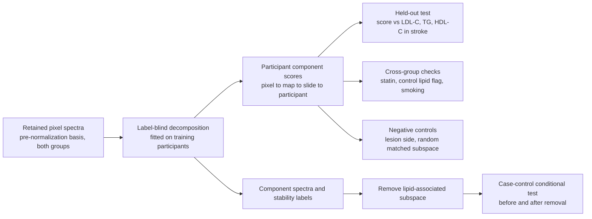

# Which part of the EV-fraction Raman signal tracks circulating lipids? Reference-free decomposition validated against the patient lipid panel

Status: research design. No analysis has been run. The hypotheses below are prespecified and untested.

Data constraint: this design uses only the existing preprocessed store and `data/clinical_master.csv`. It needs no new measurement, no reference standards, and no new clinical variables.

## Research questions

- **RQ1.** Does a spectral component exist that tracks plasma triglycerides (TG), LDL cholesterol (LDL-C) or HDL cholesterol (HDL-C) in held-out stroke participants?
- **RQ2.** How much between-participant Raman variance does that component explain?
- **RQ3.** Does the stroke–control spectral difference lie inside the subspace of that component?

## Why this matters

SEC alone does not separate plasma EVs from lipoproteins. Sódar et al. (2016, qEV columns) found that most vesicle-sized particles lacked vesicle markers and were mainly LDL. Karimi et al. (2018) found that a density cushion before SEC reduces lipoprotein contamination about 100-fold. The manuscript's fingerprint PC1 explains 75.8% of variance and loads on lipid bands (`spectra_manuscript/main.tex:360–364`). The stroke cohort has a full plasma lipid panel for 93 of 97 patients, so a lipid-tracking signal can be tested against each patient's own values.

## What this version can and cannot do

Without measured reference spectra, the decomposition cannot name a component as VLDL, LDL or HDL from its shape. A component gets its identity only from external validation against the lab values. The three lipoprotein classes will probably not separate at this noise level and sample size. The expected result is one joint lipid-associated component. That is still a testable finding, and the stability labels (below) report it as "joint" instead of naming classes.

Novelty therefore rests on the validation design: external laboratory ground truth, participant-level cross-fitting, negative controls, and stability labels. It does not rest on the decomposition architecture.

## Prior work and the gap

- Bonizzi et al. (Biosens. Bioelectron. 2025, 278:117287) profiled circulating EVs of breast cancer patients by Raman. They compared Raman estimates of major biomolecule classes with biochemical assays. A 2026 abstract from the same group extends this to plasma extracellular particles, including lipoproteins. This is the closest competitor. Only abstracts and secondary coverage were read.
- Koster et al. (Nanoscale 2021) used SERS to estimate lipoprotein contamination across isolation methods. They found HDL to be the main contaminant after ultracentrifugation and density-gradient isolation.
- Georgiev et al. (PNAS 2024) introduced physics-constrained autoencoders for Raman unmixing. Their model uses learned endmembers with non-negativity and sum-to-one constraints. The same constraint style applies here, with endmembers learned blind.
- A limited search found no study that does both of the following: (a) validates a label-blind Raman component of SEC EV-enriched fractions against each patient's plasma lipid panel in held-out participants; (b) re-tests a disease contrast after removing that component. Read the full Bonizzi papers and repeat the search before claiming priority.

## Existing data used

| Item | Value | Use |
|---|---|---|
| Retained pixel spectra | 17,725 fingerprint; 17,201 C–H | Label-free decomposition. |
| Basis | Pre-normalization matrices (baseline-corrected). Mean negative-channel fraction per spectrum: 33% (fingerprint), 37% (C–H). Mean negative area fraction about 10%. | The data stay unclipped, as the repository requires. Non-negativity applies to components and abundances only. The noise term absorbs negative values. |
| Stroke lipid panel | TG, LDL-C, HDL-C, TC for 97 patients (CRP, fibrinogen and blood counts also exist) | Anchors. TC is excluded because it is almost the same variable as LDL-C (ρ = 0.95). |
| Statin use | 32/97 stroke, 12/47 controls | Cross-group anchor. |
| Control lipid flag | "Hyperlipidemia or lipid-lowering drug": 24/47 yes, 23 no, 3 missing. Four controls on a statin have the flag set to 0, although the flag includes lipid-lowering drugs. | Weak secondary anchor. Report the inconsistency to the data owner. |
| Smoking | Current: 24/97 stroke, 7/47 controls | Carotenoid check. |
| Lesion side | Left 41, right 45, posterior 11 | Negative-control exposure. |
| Age, sex, comorbidities | Both groups | Covariates and the support rule from `06-replication-aware-normative-deviation.md`. |

## Prespecified hypotheses

| ID | Prediction | Data | Role |
|---|---|---|---|
| H1 | In held-out stroke participants, a lipid-associated component score is associated with LDL-C (primary) and TG (primary if fasting is documented; otherwise secondary). | Stroke, n ≈ 93 | Primary test. Holm correction across the primary anchors. LDL-C may be calculated from TG, which is unknown. |
| H2 | The same component is associated with HDL-C (negative direction expected). | Stroke | Secondary. |
| H3 | The component is lower in statin users, with the same sign in controls (12/47) and stroke (32/97). | Both groups | Cross-group check. Report effect sizes and intervals. The control group is too small for a powered test. |
| H4 | The component is higher in controls with the lipid flag (24/47). | Controls | Weak secondary check, given the flag inconsistency. |
| H5 | A component with high loadings on both carotenoid windows (1156 and 1525 cm⁻¹, from `src.analysis.raman_bands`) is lower in current smokers. | Both groups | Positive control. Smoking lowers plasma carotenoids in the epidemiology literature. |
| H6 | The stroke–control difference changes after removing the lipid-associated subspace. | Supported population in doc 06 | Main scientific contrast, two-sided. |
| H7 | No component differs between left- and right-hemisphere strokes (41 vs 45). | Stroke | Negative-control exposure (Lipsitch et al. 2010). |

Power: for a true Spearman ρ of 0.30 and n = 93, an in-sample test has about 84% power at α = 0.05 (Fisher z approximation). A true ρ of 0.20 gives about 49%. A cross-fitted held-out estimate loses power relative to these figures. Treat 84% as an upper bound. Measurement noise lowers it further.

## Method

### 1. Splits

Use repeated participant-level cross-validation inside the stroke cohort. All slides, maps and blocks of a participant stay in one fold. Inside each training fold, fit the decomposition on training participants only, from both groups, blind to all labels. Project held-out participants onto the learned components. This follows the repository rule that all fitting stays inside outer training folds. As a sensitivity analysis, fit once on all participants without labels.

### 2. Reference-free hierarchical decomposition

Model each retained pixel spectrum x on the pre-normalization basis:

x ≈ s · Σ_k a_k S_k + ε

- S_k (k = 1…K) are non-negative, smooth component spectra learned from the data.
- The abundances a_k are non-negative and sum to 1. The scale s > 0 absorbs droplet thickness and focus.
- ε is a noise term. It absorbs negative data values. The data are never clipped.
- Optional soft prior: encourage component mass inside the 21 curated windows of `src.analysis.raman_bands`. Use it only for initialization or weak regularization, never to assign names.
- Choose K by held-out reconstruction error and stability inside training folds.
- Pool pixel → map → slide → participant. Estimate uncertainty by bootstrapping maps and slides within participant.
- Unmix the fingerprint and C–H blocks separately, then combine at participant level.

The first implementation is alternating non-negative least squares with scipy, which is already installed. A learned encoder (a 1D CNN autoencoder with a non-negative decoder, trained without labels on training-fold pixels) is optional. It needs PyTorch, a new dependency that needs its own approval. Add it only if it beats the scipy baseline on held-out reconstruction and held-out anchor association.

### 3. Stability labels (core of doc 01)

Refit on bootstrap samples of training participants and on several seeds. Match components across fits by cosine similarity. Label each component–anchor link as separate, joint, or unresolved. Calibrate the thresholds in a simulation with known mixtures and the measured noise level. Expect "joint" or "unresolved" for TG, LDL-C and HDL-C.

### 4. Identification and held-out test

In each training fold, pick the component whose score has the strongest association with the primary anchor. In the held-out fold, record the Spearman correlation between the component score and that anchor. Pool the held-out correlations. Repeat the whole procedure, including component selection, under permuted anchors. Use `src.statistics.sequential_permutation` for the null, as the repository does for other single-statistic tests. Report the actual number of draws used.

### 5. Re-test the case-control contrast (H6)

1. Remove the identified lipid-associated subspace from each participant summary by projection.
2. Run the conditional test from `04-conditional-testing-research-proposal.md` inside the supported population from doc 06, before and after removal.
3. Run the same removal with a matched-dimension subspace that has the same variance but is chosen at random (negative control). The real removal must change the test more than the random one.
4. Report the change in the test statistic and in cross-fitted discrimination.

The interpretation has two limits. First, the subspace is identified from stroke laboratory values only, so it may also carry disease signal. A result of "the difference lies in the lipid-associated subspace" does not show that lipoproteins cause it. Second, controls have no lipid values, so group differences in lipid level cannot be separated from group differences in the component.

## Baselines

- PCA scores plus ridge or PLS regression to predict each anchor, cross-fitted. The decomposition must beat this on held-out anchor prediction. If it does not, report the simpler model.
- The curated band-ratio panel from the 21 windows (for example the ester carbonyl and carotenoid windows) against each anchor.
- Lab-supervised PLS subspace removal (learned from TG, LDL-C and HDL-C inside stroke) as an alternative for H6. It uses stroke data only and can absorb disease variance, which the label-blind route avoids.
- Ablations: no pooling; no scale term; K from 2 to 8.

## Result scenarios

| Scenario | Interpretation |
|---|---|
| A component tracks LDL-C or TG in held-out participants, and the case-control difference lies mostly inside its subspace. | The stroke difference is carried by a lipid-associated signal. This is a caution for plasma EV-Raman studies. It does not identify the particle source. |
| A component tracks lipids, and the difference remains after removal. | Something outside the lipid-associated signal differs between groups. This still does not show EV specificity. |
| No component tracks any anchor in held-out participants. | The spectra do not carry a lipid signal detectable at n ≈ 93 with this noise, or the decomposition cannot find it. Report the power limit. |

All three outcomes are publishable as an exploratory result. The third is the most likely to be dismissed, so report its power calculation.

## Open items

- Were the admission laboratory samples drawn at the same time as the EV plasma? Was the draw fasting? TG depends on fasting. The clinical master does not say. Default: assume the same admission draw, and treat TG as secondary if fasting is unknown.
- Is LDL-C measured or calculated? The default assumes unknown.
- Four controls on a statin have the control lipid flag set to 0. Ask the data owner.
- Acquisition mode FP/SS is unexplained and unbalanced by group (56% FP in controls, 43% in stroke). Include it as a technical covariate and check component scores against it.
- Sample-label meaning must be settled first (technical replicates versus two time points). See `docs/brainstorming/04-conditional-testing-research-proposal.md:21` and `spectra_manuscript/main.tex:178,192`.

## Claims

- Allowed: "A label-blind spectral component tracks plasma LDL-C in held-out participants (ρ, interval)." "The case-control difference changes by Y after removing the lipid-associated subspace."
- Not allowed: naming lipoprotein classes from spectral shape, molecular quantitation, EV specificity, brain origin, diagnostic use.

## Target journals

Analytical Chemistry or Analytica Chimica Acta if the validation design leads. Journal of Extracellular Vesicles is a stretch without an orthogonal particle measurement, which the current data cannot provide. Confirm quartile and scope at submission.

## Design diagram (conceptual)

## References

- Sódar BW et al. Low-density lipoprotein mimics blood plasma-derived exosomes and microvesicles during isolation and detection. Sci Rep 2016. https://pmc.ncbi.nlm.nih.gov/articles/PMC4834552
- Karimi N et al. Cell Mol Life Sci 2018. https://link.springer.com/10.1007/s00018-018-2773-4
- Koster et al. Nanoscale 2021. https://pubs.rsc.org/en/content/articlehtml/2021/nr/d1nr03334d
- Bonizzi et al. Biosens. Bioelectron. 2025, 278:117287. https://doi.org/10.1016/j.bios.2025.117287
- Bonizzi et al. VISPEC 2026 abstract. https://vispec2026.unipv.it/wp-content/uploads/sites/72/2026/01/ABonizzi_Abstract-Vispec-1.pdf
- Georgiev et al. Physics-constrained autoencoders for Raman unmixing. PNAS 2024; arXiv 2403.04526. https://arxiv.org/abs/2403.04526
- Lipsitch M et al. Negative controls. Epidemiology 2010. (From memory; not checked in this session.)
