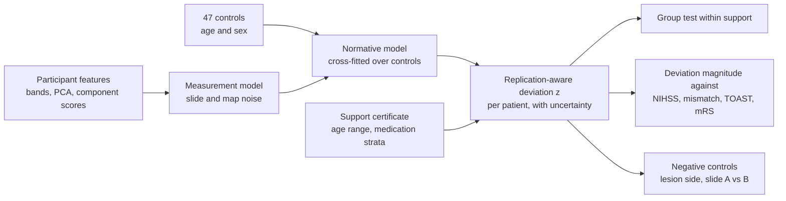

# How far is each patient from covariate-matched controls? Replication-aware normative modeling of EV Raman spectra

Status: research design. No analysis has been run. The hypotheses below are prespecified and untested.

## Research questions

- **RQ1.** After conditioning on age and sex, how far does each stroke patient's spectral profile lie from the control distribution, with uncertainty? Pre-event covariates enter as a sensitivity analysis.
- **RQ2.** Is a group-level difference still present within the population that both groups represent?
- **RQ3.** Does deviation magnitude, in any direction, track stroke phenotype: NIHSS at admission, perfusion mismatch volume, TOAST class, and 3-month mRS?

## Why this matters

Case-control means and linear correlations miss patients who deviate in different directions. Normative modeling addresses this in neuroimaging (Marquand et al. 2016; Rutherford et al. 2022). A limited search found no application to Raman or vibrational blood spectra.

The manuscript found a case-control difference but no within-stroke association (`spectra_manuscript/main.tex:430–433`). Two explanations are testable. Deviations in different directions may cancel in linear analyses. Nuisance variation from age, sex and medication may mask a common shift. Normative modeling tests both.

## Replication: why it matters

Controls contribute 1 slide × 3 maps per block. Stroke patients contribute 2 slides × 3 maps. Unequal replication affects the two feature orders differently.

- **Second-order features (between-map spread, from squared summaries): false positives.** The self-product bias depends on the number of maps. Doc 04 §9.4 gives a simulated example: with a true second moment of 0.25, the squared mean gives 0.58 at 3 maps and 0.42 at 6 maps. A naive analysis therefore creates a group difference when none exists. This is the main methodological claim.
- **First-order features (mean profiles): lost power, no false positives.** A normative model fitted to control summaries includes their larger measurement noise. Applied to the less noisy stroke summaries, it shrinks deviation scores toward zero. The naive score is conservative here.

Replication awareness matters for RQ1 and RQ2. It adds little to RQ3, because 95 of 97 stroke patients have the same replication (2 slides).

## Model

Status of data: this design uses only the existing store and `data/clinical_master.csv`. It needs no new measurement.

For participant i and spectral component k (a small set: band panel, PCA scores, or participant-level component scores from `05-lipoprotein-decomposition.md` if its stability checks pass):

- **Observation:** ȳ_i = θ_i + η_i, with measurement error η_i ~ N(0, σ²_slide / S_i + σ²_map / (3·S_i)). S_i is the number of slides, with 3 maps per slide.
- **Normative law, fitted on controls:** θ_i | c_i ~ N(μ(c_i), τ²(c_i)). μ is a low-order age spline plus a sex mean shift.
- **Sex is the weakest part of the reference.** Only 10 male controls exist, aged 50–66. The primary choice uses one age curve and one variance shared by both sexes, with sex as a mean shift. This is an assumption: it requires parallel age effects and equal variance in men and women. Sensitivity analyses: (a) sex-specific support only, which keeps 26 female and 19 male stroke patients; (b) a female-only model with 37 controls and 26 stroke patients.
- **Variance:** Controls give Var(ȳ | c) = τ² + σ²_slide + σ²_map / 3. Subtracting the measurement terms gives τ². σ²_map comes from between-map spread in both groups. σ²_slide comes from stroke slide pairs only. Assume it also applies to controls, and state this, because the data cannot test it: controls have one slide each, so their σ²_slide cannot be estimated. Two safeguards use existing data only:
  - Report every result across a range of control σ²_slide, from 0.5 to 2 times the stroke estimate. Flag any conclusion that changes within this range.
  - Run a matched-replication analysis in which each stroke patient contributes one slide, chosen by a fixed rule independent of the spectra (the lower slide number, then the higher). Both groups then have the same replication, and z uses the control total variance directly, with no σ²_slide assumption. Average the two slide choices. The cost is lost stroke data, so this is the assumption-free check, not the primary analysis.
- **Deviation:** z_i = (ȳ_i − μ̂(c_i)) / sqrt( τ̂²(c_i) + σ̂²_slide / S_i + σ̂²_map / (3·S_i) ).
- **Multivariate deviation:** Mahalanobis distance over K ≤ 10 components. The 47 controls with age limit K.
- **Second-order deviation:** apply the same model to between-map spread, using distinct-map estimators (doc 04 §9.3). This asks whether stroke fractions are more heterogeneous.

## Support certificate (from doc 02)

Report a deviation score only where controls support the patient's covariates.

- 68 of 97 stroke patients lie within the control age range of 42–76.
- 58 remain after excluding anticoagulant use, which no control has (32 male, 26 female). This is the primary supported population under the shared-age-curve assumption.
- 45 remain under sex-specific age support (26 female, 19 male).
- AF (2 controls) and CAD (1 control) cannot enter the normative model. Report them as a stratified sensitivity analysis.
- Other patients receive the label "outside control support" instead of a score.

## Calibration and tests

1. **Empirical null.** Cross-fit over controls, for example with 5 folds. Held-out control z should follow N(0, 1). Report centile coverage.
2. **Group test.** Apply the conditional score from doc 04 to deviation vectors within the supported population. Use participant-level multiplier resampling.
3. **Negative controls.** Left and right hemisphere strokes should show equal deviation. If the two slides are technical replicates, z from slide A and slide B should agree. Their ICC gives the reliability of the individual score.
4. **Clinical link (prespecified, Holm-corrected across four tests).** Test ‖z‖ against NIHSS at admission, perfusion mismatch volume, cardioembolic versus large-artery class, and 3-month mRS (ordinal). Repeat the same tests on spectral summaries adjusted for age and sex. The comparison shows whether the direction-free magnitude adds information.
   - Population: the 58 supported patients are primary. All 97 enter a secondary analysis, with extrapolated scores flagged.
   - Power: for a true Spearman ρ of 0.30 at α = 0.05, about 63% with n = 58 and about 84% with n = 93 (Fisher z approximation). Holm correction lowers both. The class comparison has fewer patients still. State this limit before the analysis.

## Representation options, in order of complexity

1. The 21-band panel and block PCA scores, which the repository already computes.
2. Participant-level component scores from `05-lipoprotein-decomposition.md`. They come from a label-blind decomposition of the existing pixel spectra and exist only if the stability checks in doc 05 pass.
3. A pixel encoder pretrained without labels (masked-spectrum modeling), fitted inside training splits, followed by distinct-map moments. Use it only if it improves held-out control calibration and simulated power over options 1 and 2. It needs PyTorch, a new dependency that needs its own approval.

## Simulations

Simulate participants with known normative laws, unequal replication (3 versus 6 maps), heterogeneous deviation directions, and covariate-overlap failures. Compare three scores: naive z, matched-replication subsampling (stroke reduced to 1 slide), and replication-aware z. Measure held-out control calibration, power, and bias of the deviation magnitude. Use 2,000 repetitions for calibration settings (doc 04 §12.1).

## Result scenarios

| Scenario | Interpretation |
|---|---|
| Deviation is elevated and tracks severity or etiology. | An individual-level Raman deviation score with calibrated uncertainty. Exploratory; needs external replication. |
| Deviation is elevated but unrelated to phenotype. | A group difference without individual clinical information. This agrees with the current manuscript, now with covariate adjustment. |
| No elevation within support. | Covariates explain the manuscript's case-control difference, or the difference lies outside common support. |

## Open items

- What does acquisition mode FP/SS mean? Model it as a technical factor. Its imbalance (56% FP in controls vs 43% in stroke) could create a deviation by itself.
- Patient blood-draw dates are missing, so freezer storage time may differ by group. Patients were enrolled 2020-07 to 2022-12; controls were drawn 2022-01 to 2023-01.
- With 47 controls, the normative model can use only a few covariates, and deviation intervals will be wide.
- Sample-label meaning must be settled first (technical replicates versus two time points). See `docs/brainstorming/04-conditional-testing-research-proposal.md:21` and `spectra_manuscript/main.tex:178,192`.

## Claims

- Allowed: "Within the supported population, patients' spectral profiles deviate from the age- and sex-conditional control distribution by Z (CI)."
- Not allowed: diagnostic thresholds, causal stroke effects, clinical decision use.

## Target journals

Pattern Recognition or Artificial Intelligence in Medicine if the replication-aware method and simulations lead. IEEE JBHI if the biomedical application leads. Confirm quartile and scope at submission.

## Design diagram (conceptual)

## References

- Marquand AF et al. Biological Psychiatry 2016: normative models. (From memory; not checked in this session.)
- Rutherford S et al. Nature Protocols 2022: normative modeling. (From memory; not checked in this session.)
- Lipsitch M et al. Epidemiology 2010: negative controls. (From memory; not checked in this session.)
- Doc 04: `docs/brainstorming/04-conditional-testing-research-proposal.md`, sections 9.3, 9.4 and 12.1.
