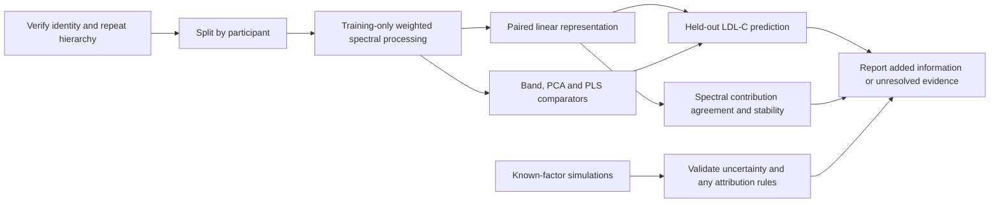

# Learning reproducible Raman features to test circulating lipid information

Design decision: 6 November 2026. Documentation and uncertainty-procedure update: 20 November 2026. Status: retrospective method development; cohort evaluation is pending the measurement and uncertainty requirements below. This is not a completed analysis or an independently registered study. Earlier cohort results were known when the design was written, so nested validation cannot remove all researcher adaptation to this cohort. All earlier proposals and their limitations remain in [the research decision history](../AGENT_LEARNINGS.md#2026-11-06-research-evidence-and-decision-history).

## Research question and intended contribution

Can a low-dimensional Raman representation learned from paired technical samples improve LDL-C prediction for unseen eligible stroke participants compared with a specified clinical/technical covariate model and established spectral methods?

The biological target is information in the retained, normalized shape of plasma EV-enriched-fraction spectra that predicts a recorded circulating lipid measurement. The computational target is a reproducible evaluation of prediction and sample agreement. A successful result would support predictive improvement within the measured cohort and protocol. It would not identify a contributing particle class, establish conditional independence failure, or show that clinical and technical confounding has been removed.

The contribution must be demonstrated against existing methods. [Serum Raman/PLS prediction of LDL and other lipid measurements](https://pubmed.ncbi.nlm.nih.gov/28271376/) and [noise-fraction spectral transformations](https://doi.org/10.1109/36.3001) are established. The paired eigensolver below is a regularized member of that broad signal-to-disagreement family, not by itself a new algorithm. The first contribution is a repeat-aware evaluation in this preparation and cohort. A separate methodological claim requires a demonstrated advantage over established comparators and calibrated attribution decisions; identification accuracy alone is insufficient.

## Evidence available and prerequisites

| Item | Current evidence | Required handling |
|---|---|---|
| Cohort | 97 stroke participants and 50 controls have spectral folders. | Participants are the independent biological units. Eligibility also requires usable spectra and verified relationships. |
| Linkage | The recorded 9 November audit retains 92 eligible participants: 88 with two eligible technical samples and four with one (180 samples). Before map QC, 90 had paired labels and two had one. | Resolve or exclude identity-review records before fitting. Recompute counts from a versioned manifest; do not quietly repair identities. |
| Repeat meaning | Investigator confirmation of one-collection technical repeats was recorded in the earlier proposal; manuscript wording conflicts. | Carry that confirmation into the measurement manifest. Document whether isolation, deposition, substrate and session were independently repeated. Do not infer longitudinal change from these pairs. |
| Anchors | LDL-C, HDL-C, TG and platelet values are populated for the 92 provisionally linked participants. Controls have no lipid values. | Confirm source units, assay definition and draw correspondence. LDL-C may be calculated. Fasting and treatment timing are unknown. Do not assume simultaneous blood draws. |
| Technical information | Sample labels, acquisition modes and QC metadata exist; physical order/session meaning is unresolved. | Keep identifiers out of predictive features. A prespecified numeric label trend may be a nuisance proxy, never evidence of physical processing order. |
| Earlier results | Stored cognitive prediction is unsupported. A reported identification pilot has no reproducible script. | Reconstruct the repeatability baseline before model development. Do not reuse the pilot's percentages as acceptance thresholds. |

Source details and dated aggregate counts are in [AGENT_LEARNINGS.md](../AGENT_LEARNINGS.md). These counts are carried forward from the dated reviews and readiness audit, not recalculated in this documentation revision. The [clinical notes](../data/clinical_master_notes.md) describe unresolved definitions and state that processed stores were not rebuilt. The 6 November review could not access the spectral store. The later engineering checks used the real store with dummy outcomes, as recorded in the 9 November evidence table; they did not reproduce the identification pilot or evaluate lipid prediction.

Known-factor simulation development is separate from real-data implementation verification. The investigator requires verification on real spectra, covariates and folds with seeded dummy outcomes; synthetic simulation results cannot substitute for that check. Before cohort evaluation, validate the cohort/participant join to the standalone clinical master and audit identity flags, source missing-value tokens and one-record-per-participant uniqueness. Existing processed clinical fields and folder-derived sex values are not a substitute. Confirm laboratory units and assay definition; if timing permits only a relationship with the recorded clinical measurement, use that narrower interpretation. If identity or the sample/assay relationship is indefensible, withhold the primary biological claim. Do not infer that the technical sample pair represents separate visits.

## Population, inputs and measurement target

Use the stroke cohort for representation learning and laboratory evaluation. Controls are reserved for a later case-control audit; they do not supply missing laboratory values and do not enter the primary model.

Preserve participant → technical sample → map → retained pixel, separately for fingerprint and C–H blocks. Start from the canonical normalized store described in [preprocessing](preprocessing.md): fingerprint 734–1788 cm⁻¹ with SNV and C–H 2451–3197 cm⁻¹ with area normalization. These inputs describe relative spectral shape, not fraction lipid mass, yield or particle concentration. The 698 and 718 cm⁻¹ features used in [Bonizzi et al.](https://doi.org/10.1016/j.bios.2025.117287) lie outside the fingerprint window. That study supports plausibility, not direct transfer of its peak measurements. Preserve the frozen grids and signed residuals; do not extrapolate, clip spectra or substitute nonnegative decomposition. A different input basis is a separate experiment.

For each sample, take the pixel median within each map, then the median across eligible maps, per block. Use only samples with both blocks and at least two eligible maps per block for the paired-representation comparison. Construct these summaries from measurement records and verified sample relationships: the existing participant-median exports collapse the pair structure. Report exclusions and retention by sample. Compare the existing three-map-complete subset as a sensitivity analysis. The claim concerns the retained-measurement process, not spectra removed by QC.

Give each participant equal weight. Average eligible sample representations equally for laboratory prediction; extra pixels or samples do not increase population weight. A participant with one eligible sample may enter laboratory prediction but cannot contribute a measured pair-agreement estimate. The primary result therefore averages over the observed mixture of one- and two-sample measurements. Repeat evaluation in the paired-only subset. In a separate sensitivity analysis, use one sample per participant for downstream regression inputs and held-out prediction, selected by a fixed label rule independent of the outcome; paired training samples remain available to fit the representation. This distinguishes representation benefit from prediction-time repeat averaging.

Record input fingerprints, source versions, linkage decisions, missingness, map counts, seeds and split assignments locally. The acquisition manifest should include available anticoagulant, processing delay, storage/freeze–thaw history, isolation preparation, deposition/substrate, dry or suspended state, session, laser settings, calibration and blanks. Mark absent information explicitly and identify which stages were independently repeated, following [MISEV2023](https://doi.org/10.1002/jev2.12404). Missing records cannot establish that preparation effects were removed. Public examples use synthetic data; participant identifiers, individual clinical values and private spectra remain local.

## Primary endpoint and comparator

The single primary comparison is the paired linear representation plus covariates against covariate-only ridge regression. Its endpoint is the participant-weighted difference in held-out LDL-C squared error:

\[
\widehat\Delta = \frac{1}{n}\sum_i\left[(y_i-\widehat y_{C,i})^2-(y_i-\widehat y_{C+Z,i})^2\right].
\]

C denotes locked clinical/technical covariates and Z the learned spectral representation. Positive values favor adding spectra. Report the difference in squared LDL-C units, relative reduction \(\widehat\Delta/\mathrm{MSE}_C\) when the denominator is positive, RMSE, MAE, and descriptive calibration intercept/slope on the confirmed laboratory scale. Do not recalibrate with outer-test outcomes. Correlation alone is insufficient; no clinical usefulness threshold is asserted.

The target is the difference in expected prediction error of the two specified training procedures on eligible participants under the observed protocol, at the outer-training size of approximately four-fifths of the available cohort. It is not automatically the risk of a final model fitted on everyone. A positive difference can arise when spectra proxy nonlinear covariate effects missed by ridge; it is not a general test of information conditional on C. Include this failure case in simulations and a sensitivity model with fixed quadratic terms for continuous covariates.

The covariates are age, sex, chronic statin use, and a linear sample-label trend as a declared technical proxy. Amendment, 9 November 2026: the investigator treats the FP and SS acquisition modes as equivalent, so maps are pooled across modes and mode proportions are not covariates. Average parsed numeric sample labels across eligible samples. Fix the parser before evaluation. Do not use participant IDs, folder names, clinical provenance or QC flags as predictors. Confirm the statin field's definition and reference time; unresolved definitions limit adjustment claims. Report constant, absent or non-estimable columns.

Sensitivity analyses remove the label trend, replace it with a quadratic term, and add measured pre-event risk factors as one fixed set documented before evaluation. Also compare the models with quadratic age and label terms together. A changing conclusion limits interpretation. Do not add severity, follow-up outcomes or acute biomarkers as routine confounders. Unmeasured preparation effects remain possible under every adjustment model.

Fit numeric standardization and median/mode imputation inside each training division, with missingness indicators and a fixed categorical encoding. Record the handling of unseen categories and entirely missing training columns. Treat source missing-value tokens as missing, never as numbers or ordinary categories. Missing LDL-C excludes that participant from this endpoint; identity and assay uncertainty are not imputed. No analytic imputation overwrites the clinical master.

## Representations and learning procedure

Evaluate the following on identical eligible participants, covariates and splits:

| Representation | Fitting rule and role |
|---|---|
| Fixed band summaries plus ridge | Freeze windows, summary functions and feature provenance before evaluation. Use externally justified bands on the normalized basis. Cohort-selected regions, minimal panels and earlier model loadings are exploratory comparators only; nested fitting cannot undo their earlier selection. Omit ratios unless a scientifically meaningful denominator rule is locked. |
| Block-scaled PCA plus ridge | Apply the same weighted spectral preprocessing as the paired method, without its pair-disagreement step. |
| PLS regression | Fit conventional PLS regression against the endpoint using concatenated standardized C and participant-average, block-scaled training spectra. Use those spectra directly, without PCA truncation or additional per-channel autoscaling. Select the number of components inside the inner divisions. Labels never enter a held-out transformation. |
| Paired linear representation plus ridge | The designated primary spectral procedure, defined below. Its dimensionality and regularization are selected inside training divisions. |

For spectral preprocessing, participant i with m_i eligible samples gives each sample weight 1/(N m_i), where N is the number of training participants. Use these weights for centering and covariance. Scale each block by the inverse square root of its leading weighted covariance eigenvalue. For the PCA and paired procedures, concatenate the scaled blocks and fit weighted PCA; PLS uses participant averages of the scaled blocks directly. This adopts the repository's MFA scaling convention; the weighted implementation is in `src/analysis/paired_lipid/models.py`. Save means, weights, block scales and projections; never refit on held-out spectra. Candidate combined PCA dimensions are 5, 10 and 15, capped by fitting-division rank and the number of paired training participants minus one; deduplicate capped candidates.

Let x_iA and x_iB be the reduced summaries of the two technical samples and let u_i=(x_iA+x_iB)/2. For n_p paired training participants, define

\[
W=\frac{1}{2n_p}\sum_i(x_{iA}-x_{iB})(x_{iA}-x_{iB})^\top,\qquad
T=\frac{1}{n_p-1}\sum_i(u_i-\bar u)(u_i-\bar u)^\top.
\]

Solve

\[
Tv_j=\rho_j(W+\lambda\tau I)v_j,\qquad
\tau=\operatorname{tr}(T)/k,
\]

where k is the reduced dimension and directions are ordered by decreasing rho_j. Normalize directions in the regularized denominator metric. Retain one, two or three directions, bounded by available rank. Use the dimensionless lambda grid {0.001, 0.01, 0.1, 1, 10}. Candidate ridge penalties are {0.001, 0.01, 0.1, 1, 10, 100, 1000} for the objective mean squared training error plus alpha times the squared coefficient norm, with an unpenalized intercept. Standardize downstream ridge predictor columns using training data. PLS considers one to five components, capped by inner-training rank. The objective convention matters when translating alpha to a library's summed-loss API.

Under independent, zero-mean, equal-covariance sample errors without systematic A/B shift, W estimates sample-error covariance and T includes participant covariance plus half that error covariance. The uncentered difference estimator intentionally retains systematic disagreement: a mean A/B shift adds half its outer product to W. Report that shift. Shared preparation effects remain in the reproducible component; correlated or unequal errors change the decomposition. None of these matrices isolates pure biology.

Only paired training participants fit W and T; other eligible training participants may fit preprocessing and downstream regression. Score candidates by participant-average inner held-out squared error, with one weight per participant. Use the same inner splits across candidates and a fixed tie rule favoring fewer retained directions/components, fewer PCA dimensions and then stronger regularization. Record n_p, rank, selected settings and failures in every division. LDL-C-guided selection makes the complete pipeline supervised. The band-input paired variant and other ablations are secondary, not extra candidates selected using outer results.

Require finite symmetric covariance matrices, positive block scales, positive tau and an adequate paired-training rank. Set numerical rank and eigenvalue tolerances in the development configuration. Mark invalid candidates with a reason; do not silently change the model or remove test participants. If a division has no valid paired candidate, report the primary procedure as not estimable under the locked design and retain the baseline results. Verify grouping in both inner and outer splits: the existing PLS tuning routine does not enforce groups for bootstrap copies.

Keep component signs deterministic through training-defined rules. Before comparing subspaces, map their projection directions back through PCA and block scaling to the common normalized spectral channels, then orthonormalize under one declared metric: equal block weight and equal channel weight within each block. Principal angles in unrelated fold coordinates are meaningless; report dimensions as well as angles. Keep all held-out predictions on the common LDL-C scale.

Report every established comparator. For a single method-performance comparison, select the strongest established procedure using inner validation only, refit it in the outer-training division, and compare its outer errors with the paired procedure. Do not select the best comparator or spectral method from outer errors and then give it an unadjusted superiority claim.

A deep encoder is outside the first implementation. Reconsider it only after the linear pipeline is reproducible and simulations show a benefit that linear methods cannot recover. A parameter-count cap alone does not justify a neural model at this participant count. Dependencies require separate approval.

## Participant divisions and uncertainty

Use one locked five-fold outer participant partition and three-fold inner selection. Record seeds before cohort model evaluation. Both samples, all maps and both blocks of a participant stay together. Allocate folds using participant membership and repeat eligibility, without searching for favorable outcomes. If verified sessions later support a session-held-out analysis, report that as a separate transportability sensitivity; random participant folds alone do not establish performance in new sessions.

Fit imputation, scaling, PCA, PLS, pair learning and model selection inside the applicable training division. Use identical outer partitions and evaluation participants across models. Three additional fixed outer partitions describe sensitivity; their folds are dependent, and the best partition is never selected as the result. Any cohort-driven redesign after inspecting the primary results must be marked exploratory and cannot reuse these results as independent confirmation.

The candidate uncertainty procedure is a 95% percentile participant-bootstrap interval from 2,000 complete refits of the nested procedure. Resample whole participants, keep each original participant's fold membership fixed, and carry multiplicity as weight or grouped copies in both outer and inner divisions. Multiplicity must weight spectral preprocessing, pair covariance estimation, downstream fitting, inner validation loss and outer error aggregation; do not collapse repeated draws to equally weighted unique participants. Covariance denominators count multiplicity, while rank limits depend on distinct paired participants. Use paired resamples for model differences. Duplicate copies may never appear on opposite sides of a split. Record distinct participant counts, failed refits and endpoint Monte Carlo stability; do not silently drop failures or treat saved fold scores as independent observations. If any bootstrap refit cannot produce the locked comparison, mark that dataset's interval procedure as failed rather than discarding resamples. This bootstrap changes the effective training diversity and is not presumed calibrated.

Before using it inferentially, evaluate interval coverage, bias, width and dataset-level interval failure rate in independent validation simulations at approximately 90 participants. Estimate the target prediction-risk difference with independent synthetic test participants and repeated training sets; quantify error in that simulated target. Separate simulation settings used for procedure development from seeds/settings used for its final check. For each prespecified core scenario, plan at least 1,000 simulation repetitions and report binomial Monte Carlo uncertainty. Count failed dataset intervals as noncoverage in unconditional coverage; also report coverage among successful intervals. A provisional feasibility gate is a 95% Wilson lower bound on unconditional coverage of at least 0.925 for the nominal 95% interval, with fewer than 1% failed dataset intervals. This is a declared development tolerance, not a theorem or cohort power calculation. Record interval width and instability even if coverage passes. These campaigns need a runtime estimate and separate approval before execution.

Implementation audit, 10 November 2026: `evaluate_bootstrap_calibration` currently checks one signal-strength setting; the configured scenario suite reports prediction and recovery rather than interval coverage for each scenario. The estimated common target averages replicate outer-model errors on one shared independent synthetic test cohort. `target_monte_carlo_se` measures training-replicate variation conditional on that cohort and excludes uncertainty from its finite size. The coverage indicators also share an estimated target, limiting an exact binomial interpretation of the Wilson summary. Before inferential use, quantify target-estimation error separately and complete the prespecified core-scenario validation; a passing flag alone does not satisfy this design. The minimum of 48 repetitions only makes the numerical gate attainable under perfect coverage; the planned minimum remains 1,000 per core scenario. This audit reviewed source code, not new simulation results.

Implementation update, 20 November 2026: `evaluate_scenario_calibration_suite` (`--calibrate-all-scenarios`) supports multi-scenario bootstrap coverage validation with resumable chunked checkpoints (`--resume`, `--cohort-grid`, `--n-test-participants`, `--scenarios`, `--interval-method`, `--run-mde-curve`) for both `ci_95_delta_mse` and `ci_95_vs_comparator` (plus `ci_95_strongest_vs_covariate` in primary evaluation), matches the training/test single-sample mixture (`DEFAULT_N_SINGLE_SAMPLE = 4` at `n = 92`), and reports crossed two-way random-effects standard errors (`target_monte_carlo_se`, `target_test_cohort_se`, `target_total_se`), tail noncoverage rates (`lower_noncoverage_rate`, `upper_noncoverage_rate`), `empirical_sd_point_estimate`, `detection_rate`, and `target_sensitivity_min_coverage` across the target's 95% uncertainty interval. Development diagnostics across the 10 initial scenarios at `n=92` (96 replicates × 250 bootstraps, `compact_grid=True`, checked against a 192-rep × 25,000-participant oracle) established that the raw percentile participant-multiplicity bootstrap suffered right-tail undercoverage (`83.3–85.4%`) on `nonlinear_proxy_linear_covariates` (fourth-order skewness and `Corr(point_est, sd) = +0.901`) and conservative overcoverage (`100%`, `1.88–2.65×` SD ratio) on `ci_95_vs_comparator` (quadratic estimation-error doubling at Kish $N_{\text{eff}} \approx n/2$). Under the revision clause below, the default candidate estimator was updated to the **centered full-procedure studentized participant-multiplicity bootstrap-$t$** (`interval_method: studentized_t`), forming $t^{*b} = (\widehat\Delta^{*b} - \overline{\widehat\Delta^*}) / \hat{s}^{*b}$ from each draw's weighted out-of-fold loss-difference SD $\hat{s}^{*b}$ and inverting $[\widehat\Delta - q_{0.975}(t^*)\hat{s}_0,\; \widehat\Delta - q_{0.025}(t^*)\hat{s}_0]$ (with raw percentile intervals retained alongside, $\hat{s} \le 10^{-12}$ counted under the non-discarding failure rule, Maritz–Jarrett quantile endpoint Monte Carlo SEs recorded, and raw draws saved in `bootstrap_draws.npz`). On the updated 5-scenario development benchmark (`n = 92`, `n_single_sample = 4`, `R = 96`, `B = 250`, `n_test = 25,000`, `compact_grid = True`), centered studentized-$t$ achieved `0.969–0.979` primary coverage across linear-signal, no-association, A/B-shift, and high-dimensional nuisance scenarios (`0.927`, 89/96 at `R = 96` on `nonlinear_proxy_linear_covariates`, rising to `0.961`, 246/256, Wilson lower `0.930`, `target_sensitivity_min_coverage = 0.953`, `0.0%` failures on a follow-up `R = 256` development check under both `n_single_sample = 4` and `n_single_sample = 2`) and `0.979–1.000` comparator coverage with `0.0%` dataset failures and `1.20–1.57×` comparator SD ratios (down from `1.88–2.65×`), while `high_dim_technical_nuisance` demonstrated clear comparator separation (`target_delta_vs_comparator = +0.0732`). Across the remaining 6 stress regimes (`R = 48`, `B = 200`, `n_test = 10,000`, development seeds), dataset failures remained `0.0%` (including `covariate_missingness` at `0.979` primary / `0.938` comparator coverage), and `correlated_ab_sample_errors` confirmed the expected paired degradation (`target_delta_vs_comparator = -0.1794`, `0.896` primary/comparator coverage at `R = 48`). The synthetic suite was expanded to 17 scenarios (10 core/legacy plus 7 stress regimes covering high-dimensional technical nuisance, strong shared preparation, correlated/unequal A/B sample errors, nonlinear spectral signal, correlated within-sample maps, and covariate missingness) plus a pre-specified MDE signal grid (`[0.0, 0.25, 0.5, 0.75, 1.0]`), and `calibration.n_test_participants` was unified at `25,000`. Coverage indicators still share one estimated target across replicates, and the planned 1,000-repetition cohort-grid (`compact_grid: false`) validation-seed campaign remains pending before inferential cohort use.

If calibration fails, revise the uncertainty procedure using synthetic development data and recheck it before cohort evaluation, or report the cohort estimate and resampling dispersion descriptively without calibrated confidence or significance claims. No interval recipe is guaranteed by ordinary nested tuning; cross-validation error dependence requires separate justification. See [Bates et al.](https://arxiv.org/abs/2104.00673) and [Bengio and Grandvalet](https://www.jmlr.org/papers/v5/grandvalet04a.html).

No conditional-association p-value is specified in the first implementation. A later procedure must define its hypothesis, preserve covariate/technical structure and pass development checks. Unrestricted anchor shuffling and an existing permutation utility are insufficient justification. Intervals for secondary comparisons are descriptive unless their inferential family and calibration are locked.

## Repeatability and biological attribution

For each paired outer-test participant, apply the fitted model separately to sample A and sample B using the same participant covariates. Report both full predictions and the spectral contribution \(s_{is}=\widehat\beta_Z^\top z_{is}\), excluding the intercept and covariate contribution. Full-prediction agreement can be high solely because C is shared; it is not sufficient evidence of spectral repeatability. Report mean paired difference and root mean squared paired difference in LDL-C units for both quantities. Compare fixed band-feature agreement as well.

Within each outer fold, report the two-way mixed-effects, single-measure, absolute-agreement ICC, treating participants as random and the two recorded technical positions as fixed. Give its exact formula and implementation reference, consistent with [ICC reporting guidance and its correction](https://pmc.ncbi.nlm.nih.gov/articles/PMC5731844/). Retain zero and negative estimates; mark values non-estimable only for a zero denominator, another degenerate calculation or a failed variance-model fit. Report fold sample counts and heterogeneity. Do not pool different fitted models into one ordinary ICC. Small fold sizes limit precision; candidate intervals must refit the full procedure and receive the same simulation scrutiny. Single-sample reliability is not the reliability of the averaged two-sample predictor.

Report multivariate discriminability and retrieval separately within each outer-test fold. Fix the distance metric, candidate construction, tie handling and chance calculation before evaluation. Compare methods with identical candidate sets and report their sizes; never pool coordinates or distances across learned bases. Neighboring labels are a sensitivity analysis, not verified same-session negatives.

Agreement assesses only the stages actually repeated. Shared isolation cannot establish isolation reproducibility; shared artefacts can remain highly reproducible. Low agreement does not establish absence of all clinical associations.

LDL-C is the sole primary endpoint. HDL-C, TG and platelet count are secondary, using the same eligible-population rules and outer membership. If their predictive pipelines are tuned to their own targets, repeat the complete inner selection and report that supervision explicitly. If validated tests are later introduced, Holm adjustment across these three paired-pipeline endpoint tests covers only that declared secondary family. Claims selected across methods, anchor sets or additional comparisons require their own prespecified family; the first report keeps them descriptive. NIHSS, mRS, MoCA and clinical heatmaps remain exploratory and cannot replace an unsuccessful LDL-C result.

Unknown fasting and treatment timing limit lipid interpretation. If LDL-C was calculated, record the confirmed formula and recognize its shared inputs with other lipid anchors; do not count them as independent corroboration or silently recalculate stored values. The [Friedewald method](https://academic.oup.com/clinchem/article-abstract/18/6/499/5676160) is one precedent, not evidence of which assay was used here. Clinical platelet count does not measure residual platelets or platelet-derived material in the fraction, and adjustment for that count does not establish preparation purity.

Attribution is a developmental secondary module. The earlier categories—stable association with a measured anchor, joint association inseparable among correlated anchors, and unresolved association—remain proposed descriptions, not validated decisions. Before assigning them, specify the association statistic, fixed anchor sets, resampling alignment, decision thresholds and definition of false separation/merging. Tune rules on synthetic development settings, then report their error rates and uncertainty on independent validation settings, including formula-linked anchors and shared technical effects. Until that step is complete, report continuous associations and stability with explicit limitations; do not issue categorical source assignments. No particle-identity or finite-sample error-control claim follows.

Under classical independent measurement errors, reliability constrains observable Pearson correlation. Outcome reliability is not measured here, so do not automatically correct clinical correlations or claim a measured reliability ceiling for rank correlations.

## Development experiments and acceptance criteria

Build synthetic paired spectra with known latent factors, smooth peaks and noise. Vary anchor correlation, formula-linked anchors, shared preparation effects, A/B shifts, unequal and correlated sample errors, nonlinear covariate effects, nonlinear spectral signal, map dependence, missingness, QC selection, technical drift related to the anchor, and participant count. Include settings where spectra add no information beyond C but help an underspecified linear C model. A technical component retained by the representation is not correctly recovered biological information.

Measure prediction-risk differences, agreement, subspace recovery, attribution errors, interval coverage/width, runtime and memory. Compare the full method with no pair-disagreement step, no technical covariates, PCA/ridge, PLS and band/ridge. Predefine effect-size scenarios and estimate detectable improvements through simulation; do not calculate power from the observed cohort effect. A public repeat dataset is optional: the [UCI Parkinson voice dataset](https://archive.ics.uci.edu/dataset/470/parkinson%2Bs%2Bdisease%2Bclassification) has triplicate measurements, but a classification task would evaluate general repeat handling, not validate LDL-C regression or this biological interpretation.

Before the first cohort endpoint evaluation, the following must be fixed and archived in the run configuration:

| Requirement | Evidence needed |
|---|---|
| Measurement readiness | Verified participant/sample linkage, eligible counts, laboratory scale/definition, timing interpretation and documented independently repeated stages. |
| Input and comparator lock | Store fingerprints, band-feature provenance, missing-data rules, covariates, label parser, sample aggregation, grids, seeds and numerical failure rules. |
| Implementation readiness | The paired-lipid package implements weighted fitting, grouped splits and complete bootstrap refits. The 9 November evidence table records real-data checks with dummy outcomes; repeat only checks affected by subsequent input or code changes. Engineering verification is separate from simulation coverage and biological evaluation. |
| Uncertainty readiness | Independent simulation results, interval construction and comparison family; failed calibration restricts reporting to descriptive evidence. |
| Attribution readiness | A frozen, separately evaluated decision rule, or an explicit decision to retain only continuous exploratory summaries. |
| Computational readiness | Estimated fits, runtime and memory, with approval for campaigns expected to exceed five minutes or incur charges. |

A supported primary improvement requires a positive estimate with a calibrated interval excluding zero. An interval spanning zero is inconclusive, not evidence of equivalence or absence. A separate method claim also requires a reproducible advantage over the established comparator selected inside training, plus demonstrated attribution capability if attribution is claimed as the innovation. Similar point estimates do not prove equivalence. When a simpler method performs comparably without demonstrated added capability, retain it and withdraw the new-method claim.

If LDL-C improvement is not supported, report the estimate and its limitations without switching anchors, labels, preprocessing or clinical outcomes to rescue the proposal. A negative or inconclusive result concerns this retained normalized input and protocol; it does not establish absence of lipid information in all Raman measurements or guarantee a Q1 contribution. Approximately 92 provisionally linked participants may leave small improvements and detailed biological separation unresolved.

This design does not authorize experiments, dependency installation, paid compute or data release. The numerical grids and simulation counts above are specifications for planning, not work already performed or permission to execute it.

## Deliverables, interpretation and venue

The first implementation should produce a private eligibility/split manifest, a baseline repeatability report that separates spectral and covariate contributions, nested held-out LDL-C predictions, all comparator errors and differences, a simulation calibration report, and a limitations table tied to source metadata. An attribution report is conditional on developing its decision rule. Keep participant-level artifacts private; publish only permitted aggregate results, synthetic fixtures and reusable method code after separate approval.

The allowed conclusion is that the specified spectral procedure improves held-out prediction of a recorded lipid measurement relative to the named comparator under the observed sampling protocol, with the reported uncertainty. It cannot identify LDL/HDL/VLDL particle contributions, EV specificity, brain origin, causal stroke effects, molecular concentrations or clinical diagnostic utility. Random participant splits provide internal validation only. Case-control separation remains a separate question requiring a preparation/session and overlap audit.

IEEE Journal of Biomedical and Health Informatics is a candidate if method development and biological evaluation are convincing. PLOS Computational Biology is a stretch requiring broad methodological value and new biological insight, as its scope states. Confirm the ranking system, category and edition at submission; neither venue fit nor Q1 status predicts acceptance. There is one active project here, not a promise of two papers from the same cohort.

## Primary literature

The targeted evidence check on 6 November 2026 added direct lipid-prediction and statistical precedents. It is not a systematic priority review. Bonizzi and MISEV full text were checked; the serum and ICC guidance citations were checked at primary-record level, with the ICC correction inspected, Green through indexed primary text, and Bates through its primary abstract. Earlier sources below remain contextual precedents, not cohort validation.

- [Silveira et al., serum Raman lipid prediction, 2017](https://pubmed.ncbi.nlm.nih.gov/28271376/): Raman/PLS modelling of LDL and other analytes in 44 serum samples; does not validate the present fraction, protocol or incremental comparison.
- [Green et al., noise-fraction transformation, 1988](https://doi.org/10.1109/36.3001): established spectral component ordering by signal/noise properties; supports the algorithmic precedent, not the proposed calibration or biological interpretation.
- [Bates, Hastie and Tibshirani, cross-validation estimands and intervals](https://arxiv.org/abs/2104.00673), and [Bengio and Grandvalet, cross-validation variance](https://www.jmlr.org/papers/v5/grandvalet04a.html): dependent errors and the target of performance estimation require explicit treatment.
- [Koo and Li, ICC guidance](https://doi.org/10.1016/j.jcm.2016.02.012), with [published correction](https://pmc.ncbi.nlm.nih.gov/articles/PMC5731844/): model, agreement definition and measurement type must be stated; it does not justify pooling fold-specific fitted predictors.
- [Huber et al., person-specific blood infrared fingerprints, 2021](https://pubmed.ncbi.nlm.nih.gov/33686065/): precedent for individual spectral information, not evidence about these Raman samples.
- [Li et al., contrastive Raman matching, 2022](https://arxiv.org/abs/2202.12549): contrastive learning itself is established.
- [Bridgeford et al., discriminability, 2021](https://journals.plos.org/ploscompbiol/article?id=10.1371/journal.pcbi.1009279): established repeatability comparator.
- [Bonizzi et al., Raman extracellular-particle biochemistry, 2025](https://doi.org/10.1016/j.bios.2025.117287): close biological precedent with biochemical fraction measurements.
- [Georgiev et al., physics-constrained Raman unmixing, 2024](https://arxiv.org/abs/2403.04526): optional comparator, not source identification by constraint alone.
- [Capraz et al., SOFA, 2026](https://www.nature.com/articles/s41467-026-74694-6): guided factors and ambiguity with correlated guides.
- [MISEV2023, published 2024](https://doi.org/10.1002/jev2.12404): particle nomenclature and co-isolate limitations.
- [UCI Parkinson repeated-voice dataset](https://archive.ics.uci.edu/dataset/470/parkinson%2Bs%2Bdisease%2Bclassification): possible general-method benchmark.
- [PLOS Computational Biology scope](https://journals.plos.org/ploscompbiol/s/journal-information): method and biological-insight requirements.
